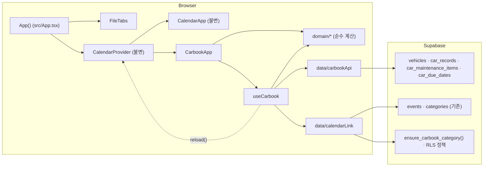
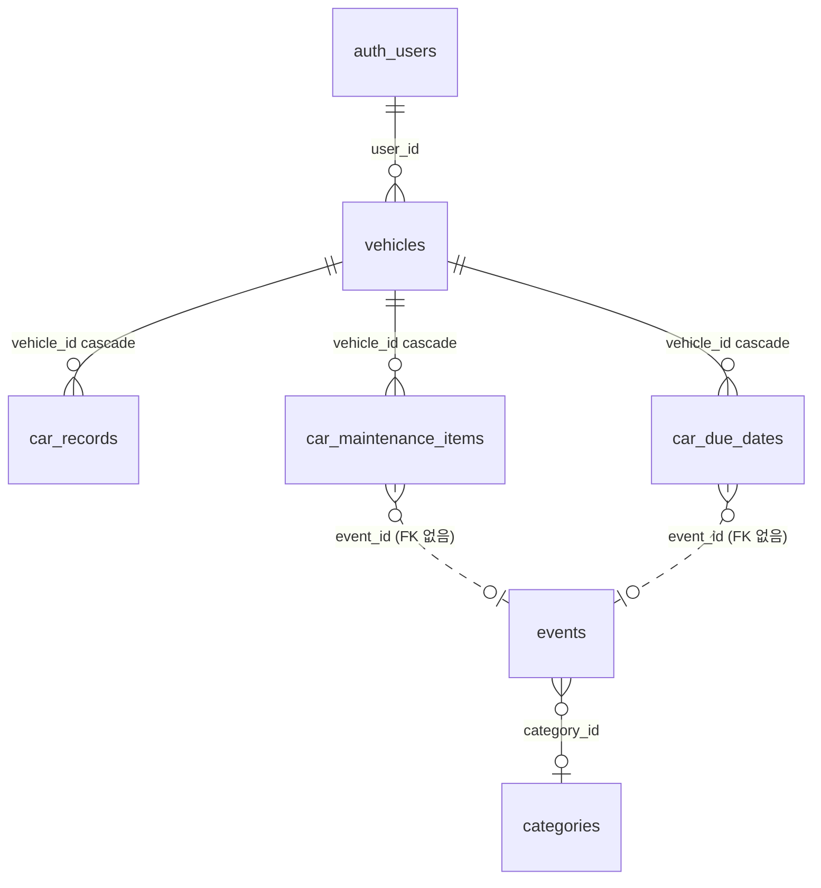

# 02 아키텍처 — 차계부

- 날짜: 2026-11-05 · 소유자: Software Architect · 상태: 제안(Product Owner 설계 검토 대기)
- 근거: [01_prd.md](01_prd.md), [03_spec.md](03_spec.md), [04_nfr.md](04_nfr.md), [research/tech.md](research/tech.md), [design/flows.md](design/flows.md)·[design/screens.md](design/screens.md)
- 결정 기록: [adr/001](adr/001-car-route-without-router.md) 주소, [adr/002](adr/002-keep-calendar-provider-on-car.md) Provider 유지, [adr/003](adr/003-linked-event-id-no-fk.md) 연결 일정, [adr/004](adr/004-carbook-category-deterministic-id.md) 카테고리, [adr/005](adr/005-hide-carbook-from-share-partners-restrictive-rls.md) 공유 숨김
- 범위: Must F-01~F-10, F-14, F-16 전부. Should F-11~F-13, Could F-15도 같은 구조에 넣는다.

## 1. 문제와 제약 (설계를 정한 것)

| 제약 | 출처 | 설계에 준 영향 |
|---|---|---|
| 캘린더 화면 컴포넌트·`useCalendar` 0줄 변경 | 원본 AC-2, AC-08-11, AC-16-5 | `App()` 함수만 고치고, 차계부는 `useCalendar().reload()`만 읽는다 |
| 라우터·새 npm 패키지 0개 | 원본 3.2, NFR-16 | History API 훅(ADR-001). 날짜 계산은 이미 있는 `date-fns` |
| 새 테이블 4개, 기존 `supabase/*.sql` 불변 | 원본 4장, PRD 8장 | 새 파일 `supabase/schema_carbook.sql` 하나에 테이블·정책·함수 |
| 공유 상대에게 숨김을 DB 정책으로 | R-16, BR-32·33 | RESTRICTIVE select 정책(ADR-005) |
| 1인 사용, 탭 2개 동시까지 | NFR-09·10 | 서버 없음, 낙관적 잠금 없음, 같은 id upsert로 수렴 |

## 2. 스택

| 층 | 선택 | 이유 |
|---|---|---|
| 화면 | 기존 React 19 + CSS Modules + `motion` | 저장소 그대로. 새 패키지 0 |
| 상태 | React 훅(`useState`/`useReducer`) 하나(`useCarbook`) | 화면 1개, 데이터 1인분. 전역 상태 라이브러리 불필요 |
| 데이터 | 기존 `src/lib/supabaseClient.ts`의 `supabase` 클라이언트로 테이블 직접 접근 + RPC 1개 | 원본 2장 A. 별도 백엔드 서버 없음 |
| 권한 | Supabase RLS | BR-33 |
| 날짜 | `date-fns`(`addMonths`는 말일 보정을 한다: `2026-01-31`+1 = `2026-02-28`, AC-06-12) | 이미 의존성에 있음 |
| 테스트 | vitest + Testing Library + jsdom(기존) | 기존 |

## 3. 구성도



## 4. 폴더 구조

```
src/
  App.tsx                      # App() 함수만 수정: 경로 분기 + FileTabs (CalendarApp 본문 불변)
  carbook/
    navigation.ts              # usePathname, navigate, isCarPath (ADR-001)
    FileTabs.tsx / .module.css # 파일철 탭(데스크톱·모바일·위젯 숨김)
    CarbookApp.tsx / .module.css  # /car 루트: 로그인 게이트, h1, main, 차량 바, 하위 탭
    components/
      LoginGate.tsx            # F-02
      VehicleBar.tsx, VehicleForm.tsx          # F-03
      RecordsTab.tsx, RecordForm.tsx           # F-04, F-05
      MaintenanceTab.tsx, MaintenanceForm.tsx, CompleteDialog.tsx   # F-06, F-12
      DueDatesTab.tsx, DueDateForm.tsx         # F-07, F-15
      StatsTab.tsx                             # F-09
      ConfirmDialog.tsx                        # F-11 (기존 Overlay 사용)
      CalendarRetryButton.tsx                  # MSG-11
    state/
      useCarbook.ts            # 데이터 읽기·쓰기·연동 조율 (화면이 쓰는 유일한 데이터 입구)
    data/
      request.ts               # 20초 제한, 오류 분류
      carbookApi.ts            # 4개 테이블 CRUD
      calendarLink.ts          # events·categories 연동(ADR-003·004)
    domain/
      types.ts                 # 아래 6장 타입
      messages.ts              # MSG-01~20 문구(글자 그대로)
      validation.ts            # 1.3과 입력 표
      odometer.ts              # BR-07, BR-08, BR-12
      fuelEconomy.ts           # BR-11
      maintenance.ts           # BR-06(추천 7개), BR-06a, BR-13, BR-14
      dueDates.ts              # F-15 빠른 선택 날짜
      titles.ts                # BR-20, F-07 일정 제목
      stats.ts                 # BR-26
      dateKey.ts               # 오늘(지역 날짜), YYYY-MM-DD 비교·더하기
supabase/
  schema_carbook.sql           # 테이블 4개, RLS, 인덱스, 함수 3개, RESTRICTIVE 정책 2개
```
- 테스트 파일은 대상 옆에 `*.test.ts(x)`(기존 규칙).
- 새 파일 첫 줄은 한국어 한 줄 역할 주석(저장소 규칙).

## 5. 모듈 경계 (누가 무엇을 부르나)

| 모듈 | 부를 수 있는 것 | 부르면 안 되는 것 |
|---|---|---|
| `domain/*` | `date-fns`, 같은 폴더 | React, `supabase`, `data/*`, `state/*` (순수 함수만) |
| `data/*` | `supabase` 클라이언트, `domain/types` | React, 화면 |
| `state/useCarbook` | `data/*`, `domain/*`, `useToast`, `useCalendar().reload` | 화면 컴포넌트 |
| `components/*`, `CarbookApp` | `useCarbook`, `domain/*`(표시 계산·검사·문구), 기존 `Overlay`, `useToast` | `supabase`, `data/*` 직접 호출 |
| `FileTabs`, `navigation` | `widgetMode.isWidgetMode`, `useMediaQuery` | `useCarbook` |
| 기존 캘린더 코드 | — | `src/carbook/*`를 import하지 않는다 |

- 화면은 `useCarbook`이 준 값만 그린다. 쓰기 결과는 `Promise<boolean>`(true = 행 저장 성공)이고, 실패 토스트는 `useCarbook`이 띄운다(한 곳). 화면은 false면 양식을 닫지 않는다(BR-27).
- 입력 검사(MSG-05~09, 15~17, 19, 20)와 주행거리 감소 경고(MSG-10)는 화면이 `domain/validation`·`domain/odometer`로 저장 전에 한다. `useCarbook`은 검사된 값만 받는다.

## 6. 계약: 타입과 `useCarbook` 인터페이스

정식 계약 문서는 API Designer가 `docs/api/carbook.md`로 쓴다. 아래는 그 출발점이고, 이 둘이 다르면 `docs/api/carbook.md`가 우선한다.

```ts
// domain/types.ts
export type RecordKind = 'fuel' | 'maintenance' | 'wash' | 'insurance' | 'tax' | 'parking' | 'other'
export type DueKind = 'insurance' | 'car_tax' | 'inspection'
export type DateKey = string // 'YYYY-MM-DD'

export interface Vehicle { id: string; name: string; model: string | null; year: number | null; plate: string | null; odometerKm: number | null; createdAt: string }
export interface CarRecord { id: string; vehicleId: string; kind: RecordKind; date: DateKey; amountWon: number; odometerKm: number | null; liters: number | null; fullTank: boolean; memo: string | null; createdAt: string }
export interface MaintenanceItem { id: string; vehicleId: string; name: string; intervalKm: number | null; intervalMonths: number | null; lastDate: DateKey; lastOdometerKm: number | null; eventId: string | null; createdAt: string }
export interface DueDate { id: string; vehicleId: string; kind: DueKind; dueDate: DateKey; eventId: string | null; createdAt: string }

export type VehicleInput = Omit<Vehicle, 'id' | 'createdAt'>
export type RecordInput = Omit<CarRecord, 'id' | 'createdAt' | 'vehicleId'>   // kind≠fuel이면 liters=null, fullTank=false (BR-10)
export type ItemInput = Pick<MaintenanceItem, 'name' | 'intervalKm' | 'intervalMonths' | 'lastDate' | 'lastOdometerKm'>

export type ItemStatus = 'ok' | 'soon' | 'overdue'
export interface ItemView extends MaintenanceItem { nextDate: DateKey | null; remainingKm: number | null; status: ItemStatus; calendarFailed: boolean }
export interface DueDateView extends DueDate { calendarFailed: boolean }
export interface EconomySegment { endRecordId: string; endDate: DateKey; kmPerL: number } // 소수 첫째 자리 반올림 전 값
```

```ts
// state/useCarbook.ts — CarbookApp이 userId가 있을 때만 호출한다(F-02: 비로그인이면 호출 자체가 없음)
export function useCarbook(userId: string): {
  loadState: 'loading' | 'ready' | 'error'   // error → MSG-04 + 다시 시도
  retryLoad(): void
  vehicles: Vehicle[]                         // created_at 오름차순
  selectedVehicleId: string | null            // 기본: 가장 먼저 만든 차량(1.5)
  selectVehicle(id: string): void
  recordsState: 'loading' | 'ready' | 'error' // 선택 차량 기록
  records: CarRecord[]                        // BR-09 정렬(날짜 내림차순, 같은 날은 created_at 내림차순)
  currentOdometerKm: number                   // BR-07
  items: ItemView[]                           // 선택 차량, AC-06-16 정렬(domain sortItems: 지남→곧 교체→정상, 각각 다음 교체일 오름차순, 날짜 없음 맨 뒤)
  dueDates: DueDateView[]                     // 선택 차량
  economy: EconomySegment[]                   // BR-11, 구간 끝 날짜 오름차순
  saveVehicle(input: VehicleInput, id?: string): Promise<boolean>
  deleteVehicle(id: string): Promise<boolean>
  saveRecord(input: RecordInput, id?: string): Promise<boolean>
  deleteRecord(id: string): Promise<boolean>
  saveItem(input: ItemInput, id?: string): Promise<boolean>
  completeItem(id: string, done: { date: DateKey; odometerKm: number | null }): Promise<boolean>
  deleteItem(id: string): Promise<boolean>
  saveDueDate(kind: DueKind, dueDate: DateKey): Promise<boolean>  // 종류당 1개(BR-16): 있으면 수정
  deleteDueDate(kind: DueKind): Promise<boolean>
  retryCalendar(target: { type: 'item' | 'due'; id: string }): Promise<void>
}
```
- 쓰는 중 중복 제출 방지(AC-10-2)는 화면이 저장 버튼을 비활성으로 한다. `useCarbook`도 같은 대상의 쓰기가 진행 중이면 두 번째 호출은 요청을 보내지 않고 `false`를 돌려준다(요청 1건, 토스트 없음).
- 반영 시간(NFR-03): 쓰기 성공 응답의 행으로 상태를 바로 바꾼다(다시 불러오기 없음). 실패면 상태를 바꾸지 않는다(낙관적 갱신 없음 → BR-27 되돌리기 불필요).

## 7. 데이터 모델 개요

원본 4장 그대로. 정확한 DDL·제약은 Database Engineer가 `supabase/schema_carbook.sql`과 `docs/db.md`에 쓴다(티켓 9장).



| 결정 | 내용 | 근거 |
|---|---|---|
| id | 4개 테이블 `id uuid primary key default gen_random_uuid()`. 클라이언트가 보내면 그 값 | 기본값이 있어도 클라이언트 지정 가능 |
| 소유 | `user_id uuid not null default auth.uid() references auth.users(id) on delete cascade` | 원본 4장, NFR-37 |
| 소속 | 딸린 3개 테이블 `vehicle_id uuid not null references vehicles(id) on delete cascade` | 원본 4장 |
| RLS | 4개 테이블 모두 켬. select/insert/update/delete 각각 `auth.uid() = user_id`(insert·update는 `with check`) | NFR-24 |
| check 제약 | `kind` 값 목록, 숫자 범위(1.3), 글자 수(1.3), `interval_km is not null or interval_months is not null` | 원본 4장, 화면 검사와 같은 값(이중 방어) |
| 유일 | `car_due_dates (vehicle_id, kind)` unique | BR-16 |
| 차량 소속 일치 | 딸린 행의 `vehicle_id`가 본인 차량인지 확인하려고 딸린 3개 테이블의 insert·update 정책 `with check`에 `exists (select 1 from vehicles v where v.id = vehicle_id and v.user_id = auth.uid())`를 더한다 | 남의 차량 id로 행을 끼워 넣는 것 방지 |
| 인덱스 | `(user_id)`, `(vehicle_id)`, `car_records (vehicle_id, date)`, `event_id` 2개 | NFR-02, ADR-005 |
| 연결 | `event_id uuid null`, FK 없음 | ADR-003 |
| 함수 | `carbook_category_id(uuid)`, `ensure_carbook_category()`, `is_carbook_linked_event(uuid)` | ADR-004·005 |
| 정책 | `events_select_hide_carbook`, `categories_select_hide_carbook` (RESTRICTIVE) | ADR-005 |
| 재실행 | `create table if not exists`, `drop policy if exists`, `create or replace function` | 기존 SQL 파일과 같은 관례 |

## 8. 동작 정책

### 8.1 인증과 로그인 게이트 (F-02)
- `CarbookApp`은 `useAuth()`를 쓴다. `loading`이면 로딩 표시, 5초가 지나도 `loading`이면 로그인 안내로 바꾼다(NFR-05, 타이머는 `CarbookApp` 안).
- `user`가 없으면 `useCarbook`을 부르지 않는다(로그인 안내 컴포넌트와 데이터 컴포넌트를 나눠, 데이터 컴포넌트를 렌더하지 않음). 그래서 요청 0건(AC-02-1). `CalendarProvider`의 기존 요청은 비로그인 때 원래 Supabase를 부르지 않는다(localStorage).
  - 확인 필요: 비로그인 상태에서 `CalendarProvider`가 `events`·`categories` 요청을 보내지 않는지 Frontend가 T13에서 테스트로 확인한다. 보낸다면 AC-02-1과 충돌하므로 Architect에게 알린다.
- 로그인 버튼: `signInWithGoogle(window.location.href)`(BR-04). Supabase 허용 Redirect URL에 `/car` 등록은 DevOps 배포 전 확인(A-2, NFR-44).

### 8.2 읽기 순서 (NFR-02)
1. `/car` 진입(로그인됨): 병렬로 `vehicles`, `car_maintenance_items`, `car_due_dates`(사용자 전체, 행 수 ≤ 차량 10 × 33).
2. 선택 차량이 정해지면 그 차량의 `car_records` 전체(`vehicle_id = …`, 최대 2,000행). PostgREST 기본 상한 1,000행 때문에 `.range()`로 1,000행씩 이어 읽는다(carbook.md 8장 1).
3. 2가 끝나면 열 때 점검(8.4)을 뒤에서 돌린다. 화면은 2가 끝나면 바로 그린다(점검을 기다리지 않음).
4. 차량을 바꾸면 그 차량 기록을 읽고, 그 차량 교체 항목 중 아직 점검하지 않은 것을 점검한다.

### 8.3 쓰기와 연동 (F-08, ADR-003)
| 동작 | 순서 |
|---|---|
| 차량 추가 | ① `vehicles` insert → ② 추천 항목 7행 한 번에 insert(BR-06, 일정 없음) → ②가 실패하면 ①의 차량을 지우고 MSG-01, false |
| 차량 수정 | ① update → ② 별칭·주행거리가 바뀌었으면 BR-06a 채움 후 연결 행 동기화(BR-21 ④) |
| 기록 저장·수정·삭제 | ① 행 쓰기 → ② BR-06a 채움(빈 `last_odometer_km`을 첫 주행거리로, 일정 없음) → ③ `event_id` 있는 km 항목 동기화(BR-21 ③) |
| 교체 항목 저장·교체 완료 | ① `event_id`가 없으면 새 uuid를 정해 행과 함께 저장 → ② 날짜 계산 → 날짜 있음: upsert / 없음: 일정 삭제(`event_id` 유지) |
| 만기일 저장 | 항목과 같음(날짜는 항상 있음) |
| 항목·만기일 삭제 | ① 일정 삭제(없으면 0행 = 성공) → ② 행 삭제. ①이 실패하면 MSG-03, 행 유지 |
| 차량 삭제 | 연결 일정을 하나씩 삭제하고 그때마다 그 행 `event_id = null` → 모두 성공하면 차량 delete. 중간 실패면 멈추고 MSG-03 |
| 반영 실패 | 행 쓰기 성공 + 일정 쓰기 실패 → 그 행 `calendarFailed = true`(화면에 MSG-11). `retryCalendar`는 ② 단계만 다시 한다. 상태는 메모리에만 두고 저장하지 않는다(다시 열면 8.4가 다시 시도) |
| 동기화 판단 | `events`에서 `id, title, start_at, category_id`를 읽어 계산값과 비교, 다르면 upsert(BR-21, BR-25) |
| 캘린더 갱신 | 한 동작에서 일정 쓰기가 1건 이상 성공하면 끝에 `reload()` 한 번(ADR-002) |

### 8.4 열 때 점검 (AC-08-3, AC-08-14, ADR-003·004)
1. `event_id`가 있는 행의 id를 모아 `events`에서 100개씩 조회(`user_id = 나`).
2. `category_id`가 차계부 카테고리 id와 다른 일정 → `ensure_carbook_category()` 후 `update … set category_id`(한 번에).
3. 없는 일정 → 날짜를 계산할 수 있으면 같은 id로 upsert(만기일은 항상, 교체 항목은 그 차량 기록이 읽힌 뒤). 계산 불가면 건너뜀.
4. 실패한 행은 `calendarFailed = true`. 점검은 같은 화면 수명에서 행마다 한 번만.

### 8.5 오류 처리 (F-10)
| 상황 | 동작 | 문구 |
|---|---|---|
| 요청 20초 초과 | `AbortController` + `setTimeout(20000)`의 신호를 supabase 쿼리 `.abortSignal()`에 넣어 실패로 처리(NFR-08, 가짜 타이머 테스트 가능) | 쓰기 MSG-01, 삭제 MSG-03, 읽기 MSG-04 |
| 네트워크·서버 오류 | 자동 재시도 없음. 사용자가 다시 누른다(NFR-39). supabase-js 2.116은 GET을 기본 3회 재시도하므로 모든 읽기에 `.retry(false)` | 같음 |
| unique 위반(`23505`, 두 탭에서 같은 만기일 종류 첫 저장) | 그 차량 만기일을 다시 읽고 MSG-01, 입력 유지 | MSG-01 |
| 일정 쓰기 실패 | 행은 유지, MSG-11 버튼. 토스트 없음 | MSG-11 |
| RLS 거부 | 일반 오류와 같게 처리(화면에 권한 문구를 따로 두지 않음) | MSG-01/03/04 |
| 로그 | `console.error('[carbook]', 동작 이름, error.code)`만. 행 내용·번호판 출력 금지(NFR-31) | — |
- `data/request.ts`는 오류를 `{ kind: 'timeout' | 'network' | 'conflict' | 'unknown', code?: string }`로 바꿔 던진다. `useCarbook`이 받아 토스트와 boolean으로 바꾼다.

### 8.6 외부 의존 실패
| 의존 | 실패 | 동작 |
|---|---|---|
| Supabase DB | 응답 없음·5xx | 8.5. 읽기 실패는 화면 안 MSG-04 + 다시 시도 |
| Supabase Auth 세션 복원 | 5초 넘게 응답 없음 | 로그인 안내(NFR-05) |
| `ensure_carbook_category` RPC | 실패 | 이번 일정 쓰기 전체를 반영 실패로(MSG-11). 행 저장은 유지 |
| 캘린더 `reload()` | 실패 | 무시. 60초 폴링이 보정 |

## 9. 코딩 규칙

- 기존 규칙을 따른다: TypeScript strict, 함수 컴포넌트, CSS Modules, 테스트는 옆 파일, `oxlint`.
- `src/App.tsx`는 `App()` 함수와 import 줄만 고친다. `CalendarApp` 함수 본문과 다른 캘린더 파일은 0줄(AC-08-11). 리뷰어는 `git diff --stat`으로 확인한다.
- 화면 문구는 `domain/messages.ts`에서만 가져온다(MSG 글자 그대로, 1.2).
- 날짜는 `DateKey` 문자열로 다루고 "오늘"은 `dateKey.today()` 하나로 얻는다(테스트에서 고정). `new Date('YYYY-MM-DD')`(UTC 해석) 금지.
- 금액·주행거리는 정수, 주유량은 소수 둘째 자리까지. 연비 표시는 소수 첫째 자리 반올림(`toFixed(1)`).
- HTML 삽입 API(`dangerouslySetInnerHTML`) 금지(NFR-29).
- 테스트에서 Supabase는 모의 객체로 바꾼다(`vi.mock('../../lib/supabaseClient')`). 계산 테스트는 03_spec 숫자 예시를 그대로 쓴다(NFR-42).
- 의존성 추가 금지(NFR-16). 필요하면 티켓으로 Architect에게. 예외 제안: 테스트 전용 `@electric-sql/pglite` devDependency(ADR-006, PO 결정 대기).

## 10. 역할별 수정 가능 폴더

| 역할 | 수정 가능 | 비고 |
|---|---|---|
| Database Engineer | `supabase/schema_carbook.sql`, `docs/db.md` | 기존 `supabase/*.sql` 금지 |
| API Designer | `docs/api/carbook.md` | |
| Backend Developer | `src/carbook/domain/**`, `src/carbook/data/**`, `src/carbook/state/**` | 화면 파일 금지 |
| Frontend Developer | `src/carbook/*.tsx`, `src/carbook/*.module.css`, `src/carbook/navigation.ts`, `src/carbook/components/**`, `src/App.tsx`(`App()`만), `src/App.test.tsx`(추가만), `src/styles/tokens.css`(파일철 탭 토큰 추가만, 기존 줄 변경 금지) | `domain/*` 변경이 필요하면 Backend에 요청 |
| UX·UI Designer | `docs/design/**` | |
| Test Automation Engineer | `supabase/*.test.ts`, `package.json`·`package-lock.json`(MPR-39의 devDependency 한 줄만) | ADR-006 승인 뒤. 스키마 SQL 금지 |
| Software Architect | `docs/02_architecture.md`, `docs/adr/**`, tasks.json 기술 티켓 | 코드 금지 |
| 모든 역할 | 캘린더 화면 컴포넌트(`src/components/**`), `src/state/useCalendar.tsx`, 기존 `supabase/*.sql` | **금지** |

## 11. 결정 요약과 PO 확인 필요

| ID | 결정 | ADR | PO 확인(2026-11-05 D-1~D-4 승인) |
|---|---|---|---|
| D-1 | OQ-2 Q4: `event_id` FK 없음. 연결 id를 행에 먼저 저장하고 같은 id로 upsert | 003 | BR-24 문구 변경 승인(결과 같음) |
| D-2 | OQ-2 Q5: 카테고리 id는 사용자별 고정값, `ensure_carbook_category()`가 PK로 중복 방지 | 004 | **원본 6장 "이름으로 찾는다"와 다름**: 차계부 도입 전에 손으로 만든 '차계부' 카테고리는 재사용하지 않음 → 승인 필요 |
| D-3 | OQ-2 Q3: 계산 불가가 되면 연결 일정 삭제, `event_id` 유지(다시 계산되면 같은 id로 복구) | 003 | BR-23 잠정값 확정 문구 |
| D-4 | R-16: 새 파일의 RESTRICTIVE select 정책. PRD 8장 허용 범위 안 | 005 | 함께 일정 참여자는 '차계부' 카테고리 일정을 계속 봄(기존 참여 동작 유지) — 확인 |
| D-5 | `/car`에서 Provider 유지, `CalendarApp`만 교체 | 002 | 없음 |
| D-6 | 차계부는 지연 로딩으로 나누지 않음(T-1-7) | 001 | 없음 |

## 12. 기술 티켓

`hive/tasks.json`에 `type: "tech"`로 만들었다(필드 `story`가 상위 스토리 MPR-1~16). 수락 기준·수정 파일·크기는 각 티켓에 있다. 각 티켓의 수정 파일은 10장 표를 넘지 않는다. 다르면 tasks.json이 우선이다.

| 티켓 | 역할 | 기능 | 내용 | 의존 | 우선 |
|---|---|---|---|---|---|
| MPR-17 | Database Engineer | F-03 | 테이블 4개·RLS·제약·인덱스 | — | P1 |
| MPR-18 | Database Engineer | F-16 | 카테고리 함수·RESTRICTIVE 숨김 정책 | 17 | P1 |
| MPR-19 | API Designer | F-08 | `docs/api/carbook.md` 계약 | — | P1 |
| MPR-20 | Backend Developer | F-10 | domain 타입·문구·오늘·입력 검사 | — | P1 |
| MPR-21 | Backend Developer | F-05 | 주행거리·평균·연비 | 20 | P1 |
| MPR-22 | Backend Developer | F-06 | 다음 교체일·상태·추천 항목·제목·빠른 선택 날짜 | 20, 21 | P1 |
| MPR-23 | Backend Developer | F-09 | 통계 계산 | 20 | P1 |
| MPR-24 | Backend Developer | F-03 | 제한 시간·오류 분류·테이블 CRUD | 19, 20 | P1 |
| MPR-25 | Backend Developer | F-08 | 캘린더 연동 함수 | 19, 22, 24 | P1 |
| MPR-26 | Backend Developer | F-04 | `useCarbook` 1 읽기·차량·기록 | 21, 22, 24 | P1 |
| MPR-27 | Backend Developer | F-08 | `useCarbook` 2 항목·만기일·연동 | 25, 26 | P1 |
| MPR-28 | Backend Developer | F-08 | `useCarbook` 3 열 때 점검 | 27 | P1 |
| MPR-29 | Frontend Developer | F-01 | 주소 훅·`App()` 분기·탭·위젯 숨김 | — | P1 |
| MPR-30 | Frontend Developer | F-14 | 모바일 탭·배치 불변 | 29 | P1 |
| MPR-31 | Frontend Developer | F-02 | `CarbookApp` 뼈대·로그인 게이트 | 20, 29 | P1 |
| MPR-32 | Frontend Developer | F-03 | 차량 바·양식·삭제 확인(F-11) | 31 | P1 |
| MPR-33 | Frontend Developer | F-04 | 기록 탭·양식·연비 표시 | 21, 32 | P1 |
| MPR-34 | Frontend Developer | F-06 | 교체 알림 탭(F-12 포함)·MSG-11 버튼 | 22, 32 | P1 |
| MPR-35 | Frontend Developer | F-07 | 만기일 탭·양식 | 32 | P1 |
| MPR-36 | Frontend Developer | F-15 | 자동차세 빠른 선택 | 22, 35 | P3 |
| MPR-37 | Frontend Developer | F-09 | 통계 탭 | 23, 31 | P1 |
| MPR-38 | Frontend Developer | F-08 | 실제 훅 연결·캘린더 반영 확인 | 28, 33, 34, 35, 37 | P1 |

- 병렬: Database(17→18), API(19), Backend(20→…→28), Frontend(29→…)가 동시에 시작할 수 있다. Frontend는 31~37에서 `useCarbook`을 6장 인터페이스대로 모의하고, 38에서 실제 훅으로 바꾼다.
- 화면 티켓(29~37)의 화면 규격은 `docs/design/screens.md`(UX)다. 규격이 확정 전이면 Delivery Manager가 DoR에서 막는다.
- 이 표에 없는 확인: Supabase Redirect URL `/car`(A-2)는 DevOps, 성능 측정(AC-01-7, AC-04-9, AC-08-12)은 QA·Performance 판정.

## 변경 기록

| 날짜 | 변경 | 이유 | 요청자 | 영향 |
|---|---|---|---|---|
| 2026-11-05 | 최초 작성, ADR-001~005 | 차계부 설계 시작 요청 | Product Owner(conv-8c399a) | 기술 티켓 생성 |
| 2026-11-05 | 11장 D-1~D-4 PO 승인, ADR-001~005 상태 승인 | PO 설계 검토(51ed15). 설계 전체 승인은 UI Designer 검토 뒤 | Product Owner | Spec Writer가 BR-23·BR-24·F-08 기본 흐름 1 문구 수정 |
| 2026-11-05 | 6장 items 정렬을 AC-06-16으로, 새 AC 3개(AC-03-9→MPR-31, AC-06-16→MPR-22·34, AC-08-15→MPR-27) 티켓 매핑 | 03_spec AC 119개 | Product Owner(f6dfae) | MPR-22·26·27·31·34 |
| 2026-11-05 | API 계약(carbook.md 8장 1~8) 승인 반영: 기록 1,000행씩 읽기, 읽기 `.retry(false)`, AbortController 제한 시간. 6장 인터페이스의 정식 내용은 carbook.md | API Designer 검토 요청(bb930b) | API Designer | MPR-17·18 메모에 DB 요구 추가 |
| 2026-11-06 | ADR-006(제안) RLS 회귀 테스트용 PGlite devDependency, 10장 Test Automation Engineer 행 | RLS 24개 케이스 자동화 요청 | Delivery Manager(conv-c368a6) | MPR-39(blocked: NFR-16 예외 PO 결정) |
| 2026-11-06 | 10장 Frontend 행에 `src/styles/tokens.css`(탭 토큰 추가만) | MPR-29 후속 티켓 2건(탭 토큰, 리뷰 제안) | Delivery Manager(conv-fe083a) | MPR-40·41 |
