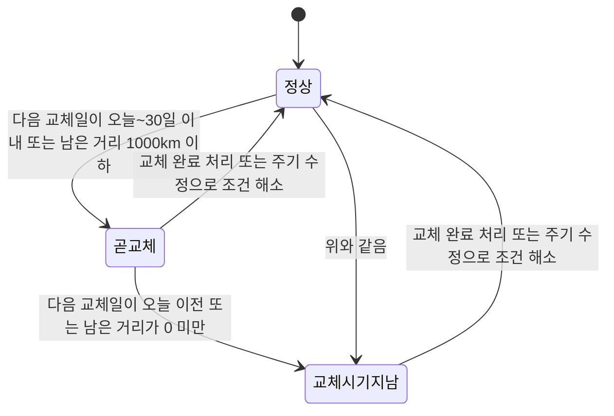
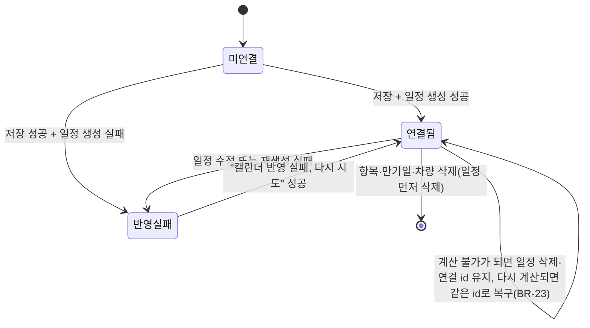

# 03 기능 명세 — 차계부

- 날짜: 2026-11-05 · 소유자: Spec Writer · 상태: 초안(Plan Reviewer 검토 대기)
- 근거: [01_prd.md](01_prd.md)(확정), [원본 설계](superpowers/specs/2026-11-05-carbook-design.md)(이하 "원본", 충돌하면 원본이 우선), [research/](research/)
- 짝 문서: [04_nfr.md](04_nfr.md)(비기능), [05_glossary.md](05_glossary.md)(용어·데이터 사전), [06_traceability.md](06_traceability.md)(R→F→AC 추적)
- 이 명세는 "무엇이 어떻게 동작하나"만 쓴다. 구현 방법(코드 구조, SQL, 훅 이름)은 Software Architect가 정한다.
- ID 규칙: 요구 R-nn(PRD) = 기능 F-nn(번호 같음). 수락 기준은 `AC-nn-k`(기능 번호 nn, 순번 k). 원본의 AC-1~11은 "원본 AC-n"으로 쓴다. 대응표는 7장.

## 0. 읽는 법과 열린 질문

- 열린 질문 SQ-1~SQ-9는 Product Owner가 2026-11-05 확정했다(11장). 이 문서에 `[가정]` 표시는 없다. 1회차 검토(plan-review.md) 반영 내역은 맨 아래 변경 기록에 있다.
- 기능 일람

| F | 이름 | 우선 | R | 원본 AC |
|---|---|---|---|---|
| F-01 | 파일철 탭과 `/car` 주소 | Must | R-01 | 1, 2 |
| F-02 | 로그인 게이트 | Must | R-02 | 3 |
| F-03 | 차량 관리 | Must | R-03 | 4 |
| F-04 | 지출·주유 기록 | Must | R-04 | 5 |
| F-05 | 연비 | Must | R-05 | 6 |
| F-06 | 교체 알림 | Must | R-06 | 7, 10 |
| F-07 | 만기일 | Must | R-07 | 8 |
| F-08 | 캘린더 연동 | Must | R-08 | 8, 9, 2 |
| F-09 | 통계 | Must | R-09 | 11 |
| F-10 | 오류 처리와 입력 검사 | Must | R-10 | 원본 7장(AC 없음) |
| F-11 | 삭제 전 확인 | Should | R-11 | — |
| F-12 | 추천 주기 안내 문구 | Should | R-12 | — |
| F-13 | 위젯 모드에서 탭 숨김 | Should | R-13 | — |
| F-14 | 모바일 탭 배치 | Must | R-14 | 1, 2 |
| F-15 | 자동차세 빠른 선택 | Could | R-15 | — |
| F-16 | 공유 상대에게 숨김 | Must | R-16 | 2 |

## 1. 공통 규칙

### 1.1 기준
- "오늘" = 사용자 브라우저의 현재 지역 날짜(한국 사용자는 KST). 날짜 형식은 `YYYY-MM-DD`. 시각은 쓰지 않는다.
- 금액은 원 단위 정수, 화면에 천 단위 쉼표(예: `45,000원`). 주행거리는 km 정수(`12,345km`). 주유량은 L, 소수 둘째 자리까지.
- 개월 더하기는 달력 기준이다. 말일을 넘으면 그 달 말일로 맞춘다(`2026-01-31` + 1개월 = `2026-02-28`).
- 화면 문구는 한국어. 아래 메시지 표의 문구를 글자 그대로 쓴다.

### 1.2 메시지

| ID | 상황 | 문구 |
|---|---|---|
| MSG-01 | 저장 실패(토스트) | 저장하지 못했습니다. 다시 시도해 주세요 |
| MSG-02 | 로그인 안 함 | 로그인하면 사용할 수 있습니다 |
| MSG-03 | 삭제 실패(토스트) | 삭제하지 못했습니다. 다시 시도해 주세요 |
| MSG-04 | 목록 불러오기 실패(화면 안, "다시 시도" 버튼 포함) | 차계부 데이터를 불러오지 못했습니다 |
| MSG-05 | 필수 입력 비어 있음 | `{항목}`을(를) 입력해 주세요 |
| MSG-06 | 정수 항목 검사 실패 | `{항목}`은(는) 0 이상의 정수로 입력해 주세요 |
| MSG-07 | 주유량 형식 오류(숫자가 아님, 음수, 소수 셋째 자리 이상). 9,999.99 초과는 MSG-17 | 주유량은 0 이상의 숫자(소수 둘째 자리까지)로 입력해 주세요 |
| MSG-08 | 연식 범위 밖 | 연식은 1950부터 `{올해+1}` 사이로 입력해 주세요 |
| MSG-09 | 교체 주기 둘 다 비어 있음 | 교체 주기는 km 또는 개월 중 하나 이상 입력해 주세요 |
| MSG-10 | 주행거리가 이전 최대보다 작음(확인창, 버튼 "저장"/"취소") | 주행거리가 이전 최대 기록(`{N}`km)보다 작습니다. 그래도 저장할까요? |
| MSG-11 | 캘린더 반영 실패(항목 옆 버튼 이름) | 캘린더 반영 실패, 다시 시도 |
| MSG-12 | 추천 주기 안내 | 참고용 값입니다. 차량 매뉴얼을 우선하세요 |
| MSG-13 | 삭제 확인(버튼 "삭제"/"취소") | `{대상}`을(를) 삭제할까요? 삭제하면 되돌릴 수 없습니다 |
| MSG-14 | 차량 삭제 확인 추가 문구 | 이 차량의 기록, 교체 항목, 만기일, 캘린더 일정이 모두 삭제됩니다 |
| MSG-15 | 날짜 형식 오류 | `{항목}`을(를) 올바른 날짜로 입력해 주세요 |
| MSG-16 | 글자 수 초과 | `{항목}`은(는) `{N}`자 이하로 입력해 주세요 |
| MSG-17 | 숫자 상한 초과 | `{항목}`은(는) `{최댓값}` 이하로 입력해 주세요 |
| MSG-18 | 다음 교체일 계산 불가 | 주행거리 기록 부족 |
| MSG-19 | 마지막 교체 주행거리 누락(km 주기 있음) | 마지막 교체 주행거리를 입력해 주세요 |
| MSG-20 | 마지막 교체일이 미래 | 마지막 교체일은 오늘 또는 그 이전 날짜로 입력해 주세요 |
| MSG-21 | 교체 주기 형식 오류(숫자가 아님, 소수, 0 이하) | `{항목}`은(는) 1 이상의 정수로 입력해 주세요 |

### 1.3 입력 검증 공통
- 모든 검사는 저장 버튼을 누를 때 실행하고, 오류는 해당 입력칸 아래에 문구로 보인다(색만으로 구분하지 않는다). 오류가 있으면 저장 요청을 보내지 않는다.
- 앞뒤 공백은 지운 뒤 검사한다. 공백만 있으면 비어 있는 것으로 본다.
- 숫자 범위: 금액 0~999,999,999 · 주행거리 0~9,999,999 · 주유량 0~9,999.99 · km 주기 1~999,999 · 개월 주기 1~600.
- 글자 수: 별칭 1~20 · 차종 0~30 · 번호판 0~15 · 교체 항목 이름 1~30 · 메모 0~200.
- 날짜 범위: 기록 날짜 `1990-01-01` ~ 오늘+365일. 마지막 교체일 `1990-01-01` ~ 오늘. 만기일 `1990-01-01` ~ 오늘+3650일.

### 1.4 역할별 권한

| 동작 | 비로그인 | 로그인 본인 | 다른 로그인 사용자 | 캘린더 공유 상대 |
|---|---|---|---|---|
| `/car` 화면 열기 | 로그인 안내만(F-02) | 가능 | 가능(자기 데이터만) | 가능(자기 데이터만) |
| 차량·기록·교체 항목·만기일 읽기 | 요청 자체 없음 | 본인 행만 | 타인 행 0건 | 타인 행 0건 |
| 같은 4가지 쓰기(추가·수정·삭제) | 불가 | 본인 행만 | 타인 행 거부 | 타인 행 거부 |
| 차계부가 만든 캘린더 일정·카테고리 보기 | 불가 | 가능 | 불가 | 불가(F-16) |
| 차계부 아닌 일정 보기 | 기존 동작 | 기존 동작 | 기존 동작 | 기존 동작(변화 없음) |

- 권한은 DB 정책(RLS, `auth.uid() = user_id`)으로 막는다. 화면 숨김만으로 막았다고 보지 않는다(BR-33).

### 1.5 화면 구성(원본 3.3)
- 상단: 차량 선택(여러 대), 차량 추가 버튼, 차량 정보 카드(차종, 연식, 번호판, 현재 주행거리).
- 하위 탭 4개: 기록 · 교체 알림 · 만기일 · 통계. 처음 열면 "기록". 하위 탭은 주소를 바꾸지 않는다(`/car` 유지).
- 차량이 0대이면 하위 탭 대신 "차량을 추가해 주세요" 문구와 차량 추가 버튼만 보인다.
- 선택된 차량은 처음 열 때 가장 먼저 만든 차량이다. 새로고침하면 다시 그 차량이고 하위 탭은 "기록"이다.
- 차량을 바꿔도 보고 있던 하위 탭은 유지된다(UX 설계 UA-1, PO 수락). 차량이 0대이면 하위 탭이 없다.

### 1.6 상태 전이도

교체 항목의 표시 상태(F-06):

- "다음 교체일 계산 불가"(MSG-18)는 상태가 아니라 다음 교체일 칸의 표시다. 판정 근거(다음 교체일, 남은 거리)가 하나도 없으면 상태는 정상(배지 없음)이다(BR-14).

항목·만기일 한 줄과 캘린더 일정의 연결 상태(F-08):

## 2. 기능 명세

### F-01 파일철 탭과 `/car` 주소 (R-01, Must)

- 목적: 캘린더 화면에서 차계부로 오가는 길을 준다.
- 사용자 스토리: 로그인한 사용자로서, 캘린더 화면의 오른쪽 가장자리 "차계부" 탭을 눌러 차계부를 열고 "캘린더" 탭으로 돌아오고 싶다.
- 사전 조건: 없음(로그인 여부와 무관하게 탭은 보인다. 비로그인 처리는 F-02).
- 기본 흐름
  1. 화면 오른쪽 가장자리에 세로 탭 2개("캘린더", "차계부")가 항상 보인다. 현재 화면의 탭은 앞으로 튀어나온 모양이고 `aria-current="page"`를 가진다.
  2. "차계부" 탭을 누르면 주소가 `/car`가 되고 차계부 화면이 보인다(기록 탭).
  3. "캘린더" 탭을 누르면 주소가 `/`가 되고 캘린더 화면이 보인다.
  4. 브라우저 뒤로·앞으로 가기는 주소와 화면을 함께 바꾼다.
  5. `/car`에서 새로고침하면 `/car`가 그대로 열린다.
- 예외 흐름
  - 알 수 없는 주소(`/abc`)는 지금처럼 캘린더로 보인다.
  - `/car/`(끝 슬래시)는 `/car`와 같게 처리한다.
  - `/share/<id>`는 지금 동작 그대로다(탭이 영향을 주지 않는다).
  - Ctrl·Cmd·Shift 누른 클릭과 가운데 클릭은 가로채지 않고 브라우저 기본(새 탭 열기)에 맡긴다.
  - 같은 탭을 다시 누르면 주소 기록을 쌓지 않는다.
- 비즈니스 규칙
  - BR-01: `/car`와 `/car/`는 같은 화면이다. 그 밖의 알 수 없는 경로는 캘린더다.
  - BR-02: 탭은 링크(`href="/car"`, `href="/"`)다. 탭은 `<nav aria-label="화면 전환">` 안에 있고 DOM 순서는 본문 뒤다.
  - BR-34: `/car`에서는 캘린더 화면 컴포넌트와 그 키보드 단축키(`n`, `t`, `m`, `/` 키)가 동작하지 않는다. 캘린더 데이터와 보기·선택일 상태는 `/`로 돌아와도 유지된다.
  - BR-35: 탭 때문에 캘린더 요소의 크기·위치가 바뀌지 않는다. 탭은 기존 레이아웃 위에 겹친다.
- 입력: 없음.
- 수락 기준
  - AC-01-1 탭으로 이동: Given 로그인한 사용자가 `/`의 캘린더 화면에 있다 / When "차계부" 탭을 누르면 / Then 주소가 `/car`이고 차계부 화면(기록 탭)이 보이며, "캘린더" 탭을 누르면 주소가 `/`이고 캘린더 화면이 보인다.
  - AC-01-2 뒤로·앞으로·새로고침: Given `/`에서 "차계부" 탭으로 `/car`에 왔다 / When 뒤로 가기를 누르면 / Then `/`와 캘린더가 보이고, 앞으로 가기를 누르면 `/car`와 차계부가 보이며, `/car`에서 새로고침해도 `/car`가 열린다.
  - AC-01-3 알 수 없는 주소와 끝 슬래시: Given 주소가 `/abc` / When 앱을 열면 / Then 캘린더가 보인다. Given 주소가 `/car/` / When 앱을 열면 / Then `/car`와 같은 차계부 화면이 보인다.
  - AC-01-4 새 탭 열기: Given 캘린더 화면 / When "차계부" 탭을 Ctrl(Mac은 Cmd)+클릭하면 / Then 현재 탭의 주소와 화면은 그대로이고 새 탭이 `/car`를 연다.
  - AC-01-5 캘린더 불변: Given 탭이 없던 때의 캘린더 화면 요소(헤더, 월 그리드, 사이드바, 버튼)의 위치·크기를 기록해 둔다 / When 탭이 있는 화면에서 같은 요소를 재면 / Then 모든 요소의 위치·크기가 같고 기존 캘린더 테스트가 전부 통과한다(원본 AC-2).
  - AC-01-6 단축키 격리: Given `/car` 화면에서 입력창이 아닌 버튼에 포커스가 있다 / When `n` 키를 누르면 / Then 새 일정 편집창이 열리지 않는다.
  - AC-01-7 전환 시간: Given 데스크톱 캘린더 화면 / When "차계부" 탭 클릭부터 화면 전환 완료까지(데이터 로딩 제외)를 10회 재면 / Then p95가 100ms 이하다(NFR-01).

### F-02 로그인 게이트 (R-02, Must)

- 목적: 로그인하지 않은 사용자에게 데이터를 보이지도 요청하지도 않는다.
- 사용자 스토리: 비로그인 사용자로서, 차계부를 누르면 왜 못 쓰는지와 로그인 방법을 알고 싶고, 로그인 뒤 차계부로 돌아오고 싶다.
- 사전 조건: 로그인하지 않음.
- 기본 흐름
  1. `/car`를 열면 MSG-02 문구와 "로그인" 버튼만 보인다. `vehicles`, `car_records`, `car_maintenance_items`, `car_due_dates` 4개 테이블과 `events`·`categories`로 가는 요청이 0건이다.
  2. "로그인"을 누르면 현재 주소(`/car`)를 돌아올 주소로 Google 로그인을 시작한다.
  3. 로그인이 끝나면 `/car`로 돌아와 차계부(기록 탭)가 보인다.
- 예외 흐름
  - 로그인 취소·실패: 안내 화면에 그대로 머문다. 기존 로그인 오류 처리와 같다.
  - 로그인 상태 확인 중(세션 복원 전): 안내 문구를 깜빡이지 않고 로딩 표시를 보여 준다. 로딩은 최대 5초(NFR-05)이고 그 뒤에는 안내를 보인다.
  - 로그인 중 세션이 만료되면 다음 요청이 실패하며, 목록 영역에 MSG-04가 보인다.
  - 이미 로그인한 사용자는 이 화면을 보지 않는다.
- 비즈니스 규칙
  - BR-03: 비로그인이면 차계부 관련 데이터 요청을 보내지 않는다.
  - BR-04: 로그인 복귀 주소는 현재 주소(`window.location.href`)다. 이 값이 Supabase 허용 Redirect URL에 있어야 한다(PRD 가정 A-2).
  - 로컬 저장은 지원하지 않는다. 비로그인 상태에서 입력한 것을 저장하지 않는다.
- 입력: 없음.
- 수락 기준
  - AC-02-1 안내와 무요청: Given 로그인하지 않았다 / When `/car`를 열면 / Then MSG-02 문구와 로그인 버튼이 보이고, 차계부 4개 테이블·`events`·`categories`로 가는 요청이 0건이다(원본 AC-3).
  - AC-02-2 로그인 복귀: Given 로그인하지 않고 `/car`의 안내 화면에 있다 / When 로그인 버튼을 눌러 로그인을 마치면 / Then 주소가 `/car`이고 차계부가 보인다(`/`로 가지 않는다).
  - AC-02-3 로그인 실패: Given 안내 화면에서 로그인을 시작했다 / When 로그인이 취소되거나 실패하면 / Then `/car`의 안내 화면이 그대로 보이고 차계부 데이터 요청은 0건이다.
  - AC-02-4 탭은 보임: Given 로그인하지 않았다 / When `/`를 열면 / Then 파일철 탭 2개가 보이고 "차계부" 탭을 누르면 `/car`의 안내 화면이 보인다.
  - AC-02-5 세션 복원 지연: Given 세션 복원 응답이 5초 넘게 걸린다 / When `/car`를 열면 / Then 복원 중에는 로딩 표시가 보이고, 5초가 되면 로그인 안내가 보인다(NFR-05).

### F-03 차량 관리 (R-03, Must)

- 목적: 차량 여러 대를 등록·선택·수정·삭제한다.
- 사용자 스토리: 차가 두 대인 사용자로서, 차량마다 따로 기록을 보고 싶다.
- 사전 조건: 로그인.
- 기본 흐름
  1. 상단 "차량 추가" → 입력 양식 → "저장". 저장되면 그 차량이 선택되고 BR-06에 따라 추천 교체 항목 7개가 채워진다.
  2. 상단 선택 상자(차량 별칭 목록)에서 차량을 고르면 차량 정보 카드와 4개 하위 탭이 그 차량 기준으로 바뀐다.
  3. 차량 정보 카드의 "수정"으로 입력값을 고칠 수 있다.
  4. "삭제"는 F-11의 확인 뒤 차량과 딸린 모든 행, 연결 일정을 지운다.
- 예외 흐름
  - 입력 오류: 1.3의 규칙, 아래 입력 표.
  - 저장 실패(네트워크, 서버): MSG-01 토스트, 양식과 입력값이 그대로 남는다(BR-27).
  - 차량이 0대: 1.5의 빈 상태.
  - 같은 별칭의 차량: 허용한다(구분은 차종·번호판으로). 
  - 선택 차량을 삭제하면 남은 차량 중 가장 먼저 만든 차량이 선택된다. 남은 차량이 없으면 빈 상태.
  - 차량 수정 때 별칭이 바뀌면 그 차량의 연결 일정 제목도 새 별칭으로 바뀐다(BR-21).
  - 다른 사용자의 차량은 목록에 오지 않는다(RLS).
- 비즈니스 규칙
  - BR-05: 차량 필수 입력은 별칭 하나다. 차종·연식·번호판·주행거리는 선택이다.
  - BR-06: 차량을 새로 만들 때마다 추천 교체 항목 7개(원본 4.1: 엔진오일 10,000km/12개월, 에어컨 필터 10,000km/6개월, 에어 필터 20,000km/12개월, 타이어 위치 교환 10,000km, 브레이크 패드 점검 20,000km, 와이퍼 12개월, 배터리 점검 36개월)를 만든다. 마지막 교체일은 차량 등록일(오늘)이다. 마지막 교체 주행거리는 차량 주행거리가 있으면 그 값이고, 비어 있으면 비워 둔다(PO 결정 2026-11-05: 0으로 두면 첫 기록 때 km 항목이 모두 "교체 시기 지남"이 되기 때문). 이때 캘린더 일정은 만들지 않는다. 일정은 교체 완료·항목 저장(BR-21 ①) 때 처음 생긴다.
  - BR-06a: 마지막 교체 주행거리가 빈 항목은 남은 거리와 km 기준 날짜를 계산하지 않고(다음 교체일 칸에 MSG-18) km 기준 배지도 붙이지 않는다. 차량 주행거리가 처음 입력되거나 주행거리가 적힌 기록이 처음 저장되면, 빈 항목의 마지막 교체 주행거리를 그 값으로 채운다(둘 중 먼저 생긴 값). 이 채움은 일정을 만들지 않는다.
  - BR-07: 현재 주행거리 = max(차량 주행거리, 그 차량 기록의 주행거리 중 최댓값). 값이 없으면 0.
  - 차량 삭제 시 딸린 행(기록, 교체 항목, 만기일)은 함께 삭제되고, 연결된 일정은 행보다 먼저 삭제한다(BR-22).
- 입력 항목

| 이름 | 타입 | 필수 | 검증 규칙 | 오류 메시지 |
|---|---|---|---|---|
| 별칭(name) | 문자열 | 필수 | 1~20자 | MSG-05(별칭), MSG-16(별칭, 20) |
| 차종(model) | 문자열 | 선택 | 0~30자 | MSG-16(차종, 30) |
| 연식(year) | 정수 | 선택 | 1950 ~ 올해+1 | MSG-08 |
| 번호판(plate) | 문자열 | 선택 | 0~15자 | MSG-16(번호판, 15) |
| 현재 주행거리(odometer_km) | 정수(km) | 선택 | 0~9,999,999 | MSG-06, MSG-17 |

- 수락 기준
  - AC-03-1 여러 대 등록·선택: Given 로그인했고 차량이 0대다 / When 별칭 "출퇴근"과 "가족"으로 차량 2대를 추가하고 선택 상자에서 "가족"을 고르면 / Then 차량 정보 카드가 "가족" 정보로 바뀌고, 기록·교체 알림·만기일·통계가 "가족"의 것만 보인다(원본 AC-4).
  - AC-03-2 타 계정 격리: Given 사용자 A가 차량 1대를 등록했다 / When 사용자 B가 로그인해 차계부를 열고 직접 A의 차량을 읽거나 고치려 하면 / Then B 화면에 A의 차량이 없고 B의 요청은 0행을 읽거나 거부된다(RLS, 원본 AC-4).
  - AC-03-3 입력 오류: Given 차량 추가 양식 / When 별칭을 비우거나 연식에 1949 또는 올해+2를 넣고 저장하면 / Then 해당 칸 아래에 MSG-05 또는 MSG-08이 보이고 저장 요청은 0건이다.
  - AC-03-4 저장 실패: Given 올바른 값을 입력했고 네트워크가 끊겼다 / When 저장하면 / Then MSG-01 토스트가 보이고 양식과 입력값이 그대로다.
  - AC-03-5 수정과 별칭 연동: Given 연결 일정이 있는 차량 "출퇴근" / When 별칭을 "출근차"로 고치고 저장하면 / Then 차량 카드가 "출근차"로 바뀌고 연결 일정 제목의 `[출퇴근]`이 `[출근차]`로 바뀐다.
  - AC-03-6 삭제: Given 기록·교체 항목·만기일·연결 일정이 있는 차량 / When 삭제 확인에서 "삭제"를 누르면 / Then 차량과 딸린 행이 사라지고 연결 일정도 캘린더에서 사라지며, 다른 차량 데이터는 그대로다.
  - AC-03-7 선택 차량 삭제 후: Given 차량이 2대이고 첫째가 선택돼 있다 / When 첫째를 삭제하면 / Then 둘째가 선택된다. 둘째까지 삭제하면 "차량을 추가해 주세요" 빈 상태가 보인다.
  - AC-03-8 삭제 부분 실패: Given 연결 일정이 3건인 차량이고 두 번째 일정 삭제가 실패하도록 했다 / When 차량 삭제를 확인하면 / Then MSG-03이 보이고 차량 행은 남으며, 이미 지운 첫 일정의 연결(`event_id`)은 비워져 있어 `/car`를 다시 열어도 그 일정이 재생성되지 않는다.
  - AC-03-9 차량을 바꿔도 하위 탭 유지: Given 차량이 2대이고 "통계" 하위 탭을 보고 있다 / When 선택 상자에서 다른 차량을 고르면 / Then "통계" 탭이 그대로 보이고 내용이 새 차량 기준이다. 새로고침하면 "기록" 탭이다.

### F-04 지출·주유 기록 (R-04, Must)

- 목적: 차량 지출을 7종으로 기록한다.
- 사용자 스토리: 주유를 마친 사용자로서, 날짜·금액·종류만으로 빨리 기록하고 싶다.
- 사전 조건: 로그인, 차량 1대 이상 선택됨.
- 기본 흐름
  1. "기록" 탭의 "기록 추가" → 종류 선택(주유·정비·세차·보험·세금·주차·기타) → 입력 → "저장".
  2. 저장되면 목록에 보이고(날짜 내림차순, BR-09) 양식이 닫힌다.
  3. 목록의 항목을 누르면 수정 양식이 열린다. "삭제"는 F-11 확인 뒤 지운다.
  4. 주유 종류를 고르면 주유량(L)과 "가득 주유" 체크가 추가로 보인다. 다른 종류로 바꾸면 그 두 칸이 사라지고 값은 저장되지 않는다.
  5. 기록 탭 맨 위에 최근 연비(F-05)를 보인다.
- 예외 흐름
  - 필수 누락·형식 오류: 입력 표의 메시지, 저장 요청 0건.
  - 주행거리가 현재 주행거리 미만: MSG-10 확인창. "저장"이면 저장, "취소"이면 양식으로 돌아간다(저장을 막지 않는다, BR-08).
  - 저장·삭제 실패: MSG-01·MSG-03, 목록과 입력값 불변(BR-27).
  - 기록이 0건: "기록이 없습니다" 문구와 기록 추가 버튼.
  - 목록 불러오기 실패: MSG-04와 "다시 시도" 버튼.
  - 기록 수정·삭제로 현재 주행거리나 연비가 바뀌면 같은 화면의 값도 다시 불러오기 없이 NFR-03 시간 안에 바뀐다.
- 비즈니스 규칙
  - BR-08: 새 주행거리가 "현재 주행거리"(BR-07, 수정 중인 그 기록 자신은 제외하고 계산)보다 작으면 저장 전에 MSG-10을 보인다. 저장은 막지 않는다.
  - BR-09: 목록은 날짜 내림차순이다. 같은 날짜이면 먼저 만든 기록이 아래(나중에 만든 것이 위).
  - BR-10: 주유량·가득 여부는 종류가 주유일 때만 저장한다. 가득 주유 체크의 기본값은 해제다.
  - 기록을 저장·수정·삭제해 현재 주행거리나 평균 주행거리가 바뀌면 그 차량의 교체 항목 상태와 연결 일정이 다시 계산된다(BR-21).
- 입력 항목

| 이름 | 타입 | 필수 | 검증 규칙 | 오류 메시지 |
|---|---|---|---|---|
| 종류(kind) | 선택(7종) | 필수 | fuel, maintenance, wash, insurance, tax, parking, other 중 하나. 화면 이름은 주유·정비·세차·보험·세금·주차·기타 | MSG-05(종류) |
| 날짜(date) | 날짜 | 필수 | 유효한 날짜, 1.3 범위 | MSG-05(날짜), MSG-15(날짜) |
| 금액(amount_won) | 정수(원) | 필수 | 0~999,999,999 | MSG-05(금액), MSG-06, MSG-17 |
| 주행거리(odometer_km) | 정수(km) | 선택 | 0~9,999,999 | MSG-06, MSG-17 |
| 주유량(liters) | 소수(L) | 선택, 주유만 | 0~9,999.99, 소수 둘째 자리까지 | MSG-07(형식), MSG-17(9,999.99 초과) |
| 가득 주유(full_tank) | 체크 | 선택, 주유만 | 기본 해제 | — |
| 메모(memo) | 문자열 | 선택 | 0~200자 | MSG-16(메모, 200) |

- 수락 기준
  - AC-04-1 7종 추가: Given 차량이 선택돼 있다 / When 주유·정비·세차·보험·세금·주차·기타 각각 날짜·금액만 넣어 저장하면 / Then 7건이 모두 목록에 보이고 종류 이름이 맞다(원본 AC-5).
  - AC-04-2 수정·삭제: Given 기록 1건 / When 금액을 고쳐 저장하면 / Then 목록 금액이 바뀐다. 삭제 확인에서 "삭제"를 누르면 목록에서 사라진다(원본 AC-5).
  - AC-04-3 정렬: Given 날짜 `2026-11-01`, `2026-11-05`, `2026-11-03` 기록과 같은 `2026-11-05`에 나중에 만든 기록이 있다 / When 목록을 보면 / Then 순서가 `11-05`(나중에 만든 것), `11-05`(먼저 만든 것), `11-03`, `11-01`이다.
  - AC-04-4 필수 누락: Given 기록 양식 / When 금액을 비우고 저장하면 / Then 금액 칸 아래에 "금액을(를) 입력해 주세요"가 보이고 저장 요청이 0건이다. 날짜·종류도 같다.
  - AC-04-5 형식 오류: Given 기록 양식 / When 금액에 `-100` 또는 `12.5`, 주유량에 `abc`를 넣고 저장하면 / Then 각각 MSG-06, MSG-06, MSG-07이 보이고 저장 요청이 0건이다. 주유량 `10000`이면 MSG-17("주유량은(는) 9,999.99 이하로 입력해 주세요")이 보인다.
  - AC-04-6 주행거리 감소 경고: Given 현재 주행거리가 50,000km다 / When 주행거리 49,000으로 저장하면 / Then MSG-10("50,000km")이 뜨고 "저장"을 누르면 저장되며 "취소"를 누르면 저장되지 않고 양식이 남는다.
  - AC-04-7 저장 실패 시 입력 유지: Given 올바른 값을 입력했고 네트워크가 끊겼다 / When 저장하면 / Then MSG-01 토스트가 뜨고 양식의 모든 입력값이 그대로이며 목록에 새 기록이 없다.
  - AC-04-8 주유 전용 칸: Given 종류를 주유로 골라 주유량 30, 가득 체크를 넣었다 / When 종류를 세차로 바꿔 저장하면 / Then 저장된 기록에 주유량·가득 값이 없다.
  - AC-04-9 열기 시간: Given 차량 1대, 기록 500건, 네트워크 Fast 4G / When `/car`를 열어 기록 탭 목록이 보일 때까지 10회 재면 / Then p95가 2초 이하다(NFR-02).
  - AC-04-10 저장 시간: Given 같은 환경 / When 올바른 기록을 저장해 목록에 보일 때까지 10회 재면 / Then p95가 1초 이하이고 다시 불러오기 없이 반영된다(NFR-03).

### F-05 연비 (R-05, Must)

- 목적: 가득 주유 기록으로 연비(km/L)를 계산해 보인다.
- 사용자 스토리: 운전자로서, 주유할 때마다 연비가 갱신되길 원한다.
- 사전 조건: 선택 차량에 가득 주유 기록이 2건 이상.
- 기본 흐름
  1. 주유 기록을 저장·수정·삭제하면 연비를 다시 계산한다.
  2. 기록 탭 맨 위에 가장 최근 구간의 연비를 "연비 12.3km/L"로 보인다. 계산 가능한 구간이 없으면 "연비: 가득 주유 기록이 2건 이상 필요합니다".
  3. 구간의 끝에 해당하는 가득 주유 기록 행에는 그 구간 연비를 함께 보인다.
  4. 모든 구간의 연비는 통계 탭에도 나온다(F-09).
- 예외 흐름
  - 가득 주유 기록이 2건 미만이거나 구간 양 끝 중 하나라도 주행거리가 없으면 그 구간은 표시하지 않는다.
  - 구간 안에 주유량이 빈 주유 기록이 있으면 그 구간은 표시하지 않는다.
  - 주행거리 차이가 0 이하이거나 주유량 합이 0이면 그 구간은 표시하지 않는다(0으로 나누지 않는다).
- 비즈니스 규칙 (원본 5장)
  - BR-11: ① 차량의 주유 기록을 날짜 오름차순(같은 날은 주행거리 오름차순, 그다음 먼저 만든 순)으로 놓는다. ② 그중 가득 주유 기록들을 순서대로 이웃끼리 짝짓는다(1-2, 2-3, …). ③ 짝 (A, B)의 연비 = (B 주행거리 − A 주행거리) ÷ (A 다음 주유 기록부터 B까지, B 포함, 모든 주유 기록의 주유량 합). ④ 표시는 소수 첫째 자리 반올림.
  - 가득이 아닌 주유 기록은 짝이 되지 않고 주유량 합에만 들어간다.
- 입력: F-04 입력을 쓴다.
- 수락 기준 (예: 가득 A=`2026-10-01` 10,000km, 중간 비가득 `2026-10-10` 20L, 가득 B=`2026-10-20` 10,500km 30L)
  - AC-05-1 정상 계산: Given 위 세 주유 기록 / When 기록 탭을 보면 / Then 연비는 (10,500−10,000) ÷ (20+30) = 10.0이고 "연비 10.0km/L"가 보인다(원본 AC-6).
  - AC-05-2 가득 1건: Given 가득 주유 기록이 1건뿐이다 / When 기록 탭을 보면 / Then 연비 숫자가 없고 "가득 주유 기록이 2건 이상 필요합니다"가 보인다.
  - AC-05-3 주행거리 없음: Given 가득 기록 2건 중 하나에 주행거리가 없다 / When 기록 탭을 보면 / Then 그 구간 연비는 보이지 않는다.
  - AC-05-4 갱신: Given AC-05-1 상태 / When 가득 기록 C(`2026-11-01`, 11,100km, 40L)를 추가하면 / Then 최근 연비가 (11,100−10,500) ÷ 40 = 15.0으로 바뀌고 B 행의 구간 연비 10.0은 그대로다.
  - AC-05-5 0으로 나눔 방지: Given 가득 기록 2건의 주행거리가 같다 / When 기록 탭을 보면 / Then 오류 없이 그 구간 연비가 보이지 않는다.
  - AC-05-6 주유량 누락: Given 가득 A, 주유량이 빈 비가득 기록, 가득 B / When 기록 탭을 보면 / Then 그 구간 연비가 보이지 않는다.

### F-06 교체 알림 (R-06, Must)

- 목적: 소모품 교체 주기를 관리하고 다음 교체일과 임박·지남을 알린다.
- 사용자 스토리: 운전자로서, 엔진오일을 언제 갈아야 하는지 한눈에 보고 싶다.
- 사전 조건: 로그인, 차량 선택됨.
- 기본 흐름
  1. "교체 알림" 탭에 항목 목록을 보인다. 정렬은 교체 시기 지남 → 곧 교체 → 정상 순이고, 같은 상태는 다음 교체일이 빠른 순이며, 다음 교체일이 없는 항목은 맨 뒤다(UX 설계 UA-8, PO 수락). 한 줄: 이름, 주기(예: `10,000km / 12개월`), 마지막 교체일·주행거리, 다음 교체일, 남은 거리, 상태 배지(정상은 배지 없음, "곧 교체", "교체 시기 지남").
  2. 목록 위에 MSG-12를 보인다(F-12).
  3. "항목 추가"로 새 항목을 만들고, 항목을 눌러 이름·주기·마지막 교체 정보를 고치며, "삭제"는 F-11 확인 뒤 지운다.
  4. 항목의 "교체 완료"는 BR-15대로 마지막 교체일·주행거리를 갱신하고 다음 교체일을 다시 계산한다.
  5. 저장·교체 완료가 끝나면 캘린더 일정이 생기거나 바뀐다(F-08).
- 예외 흐름
  - 주기 둘 다 비어 있음: MSG-09. 개월 또는 km 주기 숫자 형식 오류: 입력 표.
  - km 주기가 있는데 마지막 교체 주행거리가 비어 있음: MSG-19.
  - 입력 오류·저장 실패: 저장 요청 0건 또는 MSG-01 + 입력값 유지.
  - 항목이 0개(사용자가 모두 삭제): "교체 항목이 없습니다" + 항목 추가 버튼.
  - 같은 이름 항목: 허용한다.
- 비즈니스 규칙 (원본 5장)
  - BR-12 하루 평균 주행거리: 그 차량의 주행거리가 적힌 기록(종류 무관) 중 날짜가 `오늘−90일 ~ 오늘`(양 끝 포함)인 것을 날짜 오름차순(같은 날은 주행거리 오름차순)으로 놓고, 첫 기록과 마지막 기록의 주행거리 차이 ÷ 날짜 차이(일)다. 해당 기록이 2건 미만이거나 날짜 차이가 0일이거나 주행거리 차이가 0 이하이면 평균을 구하지 않는다(= 주행거리 기록 부족).
  - BR-13 다음 교체일: ① 개월 주기가 있으면 `마지막 교체일 + 개월`. ② km 주기가 있고 마지막 교체 주행거리가 있고 평균이 있으면 남은 거리 R = `마지막 교체 주행거리 + km 주기 − 현재 주행거리`. R > 0이면 `오늘 + 올림(R ÷ 평균)`일. R ≤ 0이면 `오늘`. ③ km 주기가 있어도 마지막 교체 주행거리가 비었거나 평균이 없으면 km 쪽 날짜는 없고 MSG-18을 보인다. ④ 두 날짜가 모두 있으면 더 이른 날. ⑤ 날짜가 하나도 없으면 다음 교체일은 비고 MSG-18을 보인다(개월 주기가 없는 경우).
  - BR-14 상태: 남은 거리 R은 km 주기와 마지막 교체 주행거리가 모두 있을 때만 있다. "교체 시기 지남" = 다음 교체일이 오늘보다 앞이거나 R < 0. "곧 교체" = 지남이 아니고 (다음 교체일이 있어 오늘~오늘+30일 안이거나 R ≤ 1,000). 그 외는 정상. 날짜를 구하지 못해도 R만으로 상태를 판정한다. 날짜도 R도 없으면 정상(배지 없음)이다.
  - BR-15 교체 완료: 마지막 교체일 = 사용자가 입력한 날짜(기본값 오늘), 마지막 교체 주행거리 = 사용자가 입력한 값(기본값 현재 주행거리). 정비 기록(F-04)은 자동으로 만들지 않는다(통계 중복 방지, PO 확정).
- 입력 항목

| 이름 | 타입 | 필수 | 검증 규칙 | 오류 메시지 |
|---|---|---|---|---|
| 이름(name) | 문자열 | 필수 | 1~30자 | MSG-05(이름), MSG-16(이름, 30) |
| km 주기(interval_km) | 정수 | km·개월 중 하나 이상 | 1~999,999 | MSG-21(형식, 0 포함), MSG-17(999,999 초과), MSG-09 |
| 개월 주기(interval_months) | 정수 | km·개월 중 하나 이상 | 1~600 | MSG-21(형식, 0 포함), MSG-17(600 초과), MSG-09 |
| 마지막 교체일(last_date) | 날짜 | 필수 | 유효한 날짜, 오늘 이하(오늘 포함) | MSG-05(마지막 교체일), MSG-15, MSG-20 |
| 마지막 교체 주행거리(last_odometer_km) | 정수 | km 주기가 있으면 필수 | 0~9,999,999 | MSG-19, MSG-06, MSG-17 |

- 수락 기준 (예: 오늘 `2026-11-05`)
  - AC-06-1 추천 항목 채움: Given 차량을 새로 등록했다 / When 교체 알림 탭을 열면 / Then 원본 4.1의 7개 항목이 해당 km·개월 값으로 보인다(원본 AC-7).
  - AC-06-2 주기 수정 재계산: Given 엔진오일(12개월, 마지막 교체일 `2026-11-05`) / When 주기를 6개월로 고쳐 저장하면 / Then 다음 교체일이 `2027-05-05`로 바뀐다(원본 AC-7).
  - AC-06-3 km 계산: Given 엔진오일 km 주기 10,000, 마지막 교체 주행거리 40,000, 현재 주행거리 48,000, 최근 90일 안 주행거리 기록이 `2026-10-06` 47,000km와 `2026-11-05` 48,000km다 / When 교체 알림 탭을 보면 / Then 평균은 1,000 ÷ 30일, R=2,000, 다음 교체일은 `2026-11-05` + 60일 = `2027-01-04`다.
  - AC-06-4 둘 다 있으면 이른 날: Given AC-06-3에 개월 주기 3개월(마지막 교체일 `2026-10-01`)을 더했다 / When 보면 / Then 개월 날짜 `2027-01-01`과 km 날짜 `2027-01-04` 중 이른 `2027-01-01`이 다음 교체일이다.
  - AC-06-5 기록 부족: Given km 주기 10,000만 있고 마지막 교체 주행거리 40,000, 현재 주행거리 42,000, 최근 90일 안 주행거리 기록이 1건뿐이다 / When 보면 / Then 다음 교체일 칸에 "주행거리 기록 부족"이 보이고, 남은 거리는 8,000km로 보이며, 캘린더 일정은 만들어지지 않는다.
  - AC-06-6 곧 교체(날짜): Given 다음 교체일이 `2026-12-05`(오늘+30일) / When 보면 / Then "곧 교체" 배지가 보인다. `2026-12-06`(오늘+31일)이면 배지가 없다(원본 AC-10).
  - AC-06-7 곧 교체(거리): Given 남은 거리가 1,000km다 / When 보면 / Then "곧 교체"가 보인다. 1,001km이면 날짜 조건이 없는 한 배지가 없다(원본 AC-10).
  - AC-06-8 지남: Given 다음 교체일이 `2026-11-04`이거나 남은 거리가 −1km다 / When 보면 / Then "교체 시기 지남"이 보이고 "곧 교체"는 보이지 않는다(원본 AC-10).
  - AC-06-9 주기 검사: Given 항목 양식 / When km와 개월을 모두 비우고 저장하면 / Then MSG-09가 보이고 저장 요청이 0건이다. km 주기가 있는데 마지막 교체 주행거리가 비면 MSG-19.
  - AC-06-10 교체 완료: Given 지남 상태의 엔진오일 / When "교체 완료"에서 날짜 `2026-11-05`, 주행거리 48,000을 확인하면 / Then 마지막 교체일·주행거리가 갱신되고 배지가 사라지며 다음 교체일이 다시 계산된다.
  - AC-06-11 항목 추가·삭제: Given 교체 알림 탭 / When 이름 "타이어", 개월 주기 48, 마지막 교체일을 넣어 추가하고 삭제 확인에서 "삭제"하면 / Then 목록에 나타났다가 사라진다.
  - AC-06-12 말일 보정: Given 마지막 교체일 `2026-01-31`, 개월 주기 1 / When 보면 / Then 다음 교체일은 `2026-02-28`이다.
  - AC-06-13 주행거리 빈 차량의 추천 항목: Given 차량 주행거리를 비우고 새로 등록했다(오늘 `2026-11-05`) / When 교체 알림 탭을 보면 / Then 타이어 위치 교환과 브레이크 패드 점검은 다음 교체일 칸에 "주행거리 기록 부족"이고 남은 거리와 배지가 없으며, 엔진오일은 다음 교체일이 `2027-11-05`이고 배지가 없고, 캘린더 일정은 0건이다(BR-06, BR-06a).
  - AC-06-14 마지막 교체일 미래: Given 항목 양식 / When 마지막 교체일에 내일 날짜를 넣고 저장하면 / Then MSG-20이 보이고 저장 요청이 0건이다. 오늘 날짜는 통과한다.
  - AC-06-15 첫 기록이 기준이 됨: Given AC-06-13의 차량 / When 주행거리 48,000인 기록을 저장하면 / Then km 주기 항목의 마지막 교체 주행거리가 48,000으로 채워지고(엔진오일 남은 거리 10,000km), "교체 시기 지남" 배지가 없으며, 캘린더 일정은 만들어지지 않는다(BR-06a).
  - AC-06-16 정렬: Given 정상(다음 교체일 `2027-03-01`), 곧 교체(`2026-11-20`), 교체 시기 지남(`2026-10-01`), 곧 교체(`2026-11-10`), 다음 교체일 없음(정상) 항목이 있다 / When 교체 알림 탭을 보면 / Then 순서는 지남(`10-01`), 곧 교체(`11-10`), 곧 교체(`11-20`), 정상(`2027-03-01`), 날짜 없음이다.
  - AC-06-17 주기 0과 상한: Given 교체 항목 양식 / When km 주기에 `0`, 개월 주기에 `-1`을 넣고 저장하면 / Then 각각 MSG-21이 보이고 저장 요청이 0건이다. km 주기 `1000000`이면 MSG-17, `1`과 `999999`는 통과한다.

### F-07 만기일 (R-07, Must)

- 목적: 보험·자동차세·정기검사 날짜를 사용자가 직접 입력한다.
- 사용자 스토리: 운전자로서, 보험 만기를 입력해 두고 놓치지 않으려 한다.
- 사전 조건: 로그인, 차량 선택됨.
- 기본 흐름
  1. "만기일" 탭에 세 종류(보험 만기, 자동차세 납부, 정기검사)의 행을 보인다. 값이 없는 종류는 "날짜 없음"과 "입력" 버튼.
  2. "입력"/"수정"으로 날짜를 저장한다. "삭제"는 F-11 확인 뒤 지운다.
  3. 저장·삭제는 캘린더 일정을 만들거나 고치거나 지운다(F-08).
- 예외 흐름
  - 날짜 비어 있음·형식 오류: MSG-05(만기일)·MSG-15, 저장 요청 0건.
  - 저장·삭제 실패: MSG-01·MSG-03. 입력값 유지.
  - 날짜가 오늘 이전: 저장은 된다. 일정도 그 날짜에 만든다(지난 만기일을 기록으로 둘 수 있게). 상태 배지는 없다(만기일 탭에는 임박·지남 배지를 두지 않는다 — PRD 범위에 없음).
- 비즈니스 규칙
  - BR-16: 종류마다 차량당 1개다. 이미 있는 종류는 "수정"만 있다.
  - BR-17: 만기일은 자동으로 추정·제안하지 않는다(F-15의 빠른 선택은 사용자가 누르는 입력 보조일 뿐이다).
  - 일정 제목: 보험 → `[별칭] 보험 만기`, 자동차세 → `[별칭] 자동차세 납부`, 정기검사 → `[별칭] 정기검사 만기`.
- 입력 항목

| 이름 | 타입 | 필수 | 검증 규칙 | 오류 메시지 |
|---|---|---|---|---|
| 종류(kind) | 고정(보험·자동차세·정기검사) | 필수(행으로 정해짐) | insurance, car_tax, inspection | — |
| 만기일(due_date) | 날짜 | 필수 | 유효한 날짜, 1.3 범위 | MSG-05(만기일), MSG-15 |

- 수락 기준
  - AC-07-1 입력: Given 보험 만기가 없다 / When `2027-03-10`을 입력해 저장하면 / Then 만기일 탭에 `2027-03-10`이 보인다(원본 AC-8).
  - AC-07-2 수정·삭제: Given 보험 만기 `2027-03-10` / When `2027-04-01`로 수정하면 / Then `2027-04-01`이 보이고, 삭제 확인에서 "삭제"하면 "날짜 없음"으로 돌아간다.
  - AC-07-3 자동 추정 없음: Given 만기일이 하나도 없는 차량 / When 만기일 탭을 보면 / Then 세 종류 모두 "날짜 없음"이고 임의의 날짜가 채워져 있지 않다.
  - AC-07-4 날짜 오류: Given 입력 양식 / When 날짜를 비우거나 `2027-02-30`으로 저장하면 / Then MSG-05 또는 MSG-15가 보이고 저장 요청이 0건이다.
  - AC-07-5 저장 실패: Given 올바른 날짜를 입력했고 네트워크가 끊겼다 / When 저장하면 / Then MSG-01 토스트가 뜨고 입력값이 남으며 만기일 탭 값은 그대로다.
  - AC-07-6 종류당 1개: Given 보험 만기가 이미 있다 / When 만기일 탭을 보면 / Then 보험 행에는 "입력"이 아니라 "수정"만 있다.

### F-08 캘린더 연동 (R-08, Must)

- 목적: 교체일·만기일을 '차계부' 카테고리의 종일 일정으로 캘린더에 보인다.
- 사용자 스토리: 캘린더를 매일 보는 사용자로서, 보험 만기를 캘린더에서도 보고 싶다.
- 사전 조건: 로그인.
- 기본 흐름
  1. 처음 연동이 필요할 때(일정 쓰기 직전) 사용자별로 정해진 고정 id의 '차계부' 카테고리를 만든다. 이미 있으면 그대로 쓴다. 이름으로 찾지 않는다(ADR-004). 차계부를 열 때 연결 일정의 카테고리가 그 카테고리가 아니면(카테고리가 지워져 분류가 없어진 경우) 같은 id로 카테고리를 다시 만들어 연결 일정을 다시 묶는다(BR-19).
  2. 교체 항목·만기일을 저장(F-06, F-07)하면 날짜가 정해진 경우 종일 일정을 만든다. 이미 연결된 일정이 있으면 날짜와 제목을 고친다.
  3. 항목·만기일·차량을 삭제하면 연결 일정도 삭제한다.
  4. 차계부(`/car`)를 열 때 연결된 일정이 `events`에 없으면 같은 연결로 다시 만든다.
  5. 일정 쓰기가 끝나면 캘린더 화면이 새 일정을 보이도록 다시 불러온다(`/`로 돌아왔을 때 보임).
- 예외 흐름
  - 일정 쓰기 실패(저장 자체는 성공): 항목·만기일은 그대로 저장하고, 그 행에 MSG-11 버튼을 보인다. 버튼을 누르면 같은 일정에 대해 다시 시도하고 성공하면 버튼이 사라진다.
  - 재시도를 여러 번 눌러도 일정이 중복으로 생기지 않는다(같은 연결 id로 한 건만).
  - 일정 삭제 실패(항목 삭제 중): 항목을 지우지 않고 MSG-03을 보인다(BR-22).
  - 카테고리를 사용자가 지운 뒤: 연결 일정은 유지되고(분류만 없어짐), 다음에 차계부를 열 때 '차계부' 카테고리를 다시 만들어 연결 일정을 모두 그 카테고리로 다시 묶는다. 다시 묶이기 전에도 공유 상대에게 보이지 않아야 한다(F-16, AC-16-6).
  - 사용자가 캘린더에서 연결 일정의 제목·날짜를 고친 뒤: 다음 차계부 저장 때 계산된 값으로 덮어쓴다(BR-25).
  - 두 탭에서 동시에 처음 연동: '차계부' 카테고리가 1개, 일정이 항목당 1건이어야 한다(AC-08-13). 카테고리는 고정 id로, 일정은 행에 저장된 연결 id로 만들어 두 탭이 같은 값에 수렴한다(BR-24).
- 비즈니스 규칙
  - BR-19: 카테고리 이름은 '차계부'. 사용자당 하나이고 id는 사용자마다 고정이다(ADR-004). 차계부 도입 전에 사용자가 직접 만든 같은 이름의 카테고리는 재사용하지 않으며, 그 카테고리의 일정은 숨김 대상이 아니다(원본 6장의 "이름으로 찾는다"를 PO가 변경 승인, 2026-11-05). 연결 일정의 카테고리는 항상 이 카테고리다. 사용자가 카테고리를 지워 연결 일정의 분류가 없어지면 다음에 차계부를 열 때 같은 id로 다시 만들어 다시 묶는다.
  - BR-20: 일정은 종일, 시작일=종료일, 제목 `[차량 별칭] 항목 이름 교체 예정`(교체 항목) 또는 F-07 비즈니스 규칙의 만기일 제목. 제목에 번호판을 넣지 않는다. 메모는 비워 둔다.
  - BR-21 동기화: 시점은 ① 교체 항목 저장·교체 완료, ② 만기일 저장, ③ 기록 저장·수정·삭제로 현재 주행거리나 평균이 바뀌어 km 주기 항목의 다음 교체일이 달라질 때, ④ 차량 별칭·주행거리 수정이다. 동기화 때 연결 일정의 현재 날짜(`start_at`)와 제목(`title`)을 읽어 계산값(날짜, 제목)과 비교하고, 하나라도 다르면 계산값으로 고치며 둘 다 같으면 쓰지 않는다. 마지막 동기화 값을 저장하는 새 필드는 없다(원본 스키마 불변). `event_id`가 없는 항목은 ③④에서 일정을 만들지 않는다(일정은 ①②나 MSG-11 재시도로만 처음 생긴다).
  - BR-22: 삭제는 연결 일정을 먼저 지우고 성공하면 행을 지운다. 차량 삭제는 그 차량의 연결 일정을 하나씩 지우고, 지운 일정의 `event_id`를 그 행에서 바로 비운다(부분 실패 뒤 `/car`를 열어도 지운 일정이 재생성되지 않게). 일정 삭제가 하나라도 실패하면 차량 행과 남은 행은 그대로 두고 MSG-03을 보인다.
  - BR-23: 다음 교체일을 계산할 수 없으면 일정을 만들지 않는다(원본 6장). 연결 일정이 이미 있었는데 계산 불가가 되면 그 일정을 삭제하되 연결 id(`event_id`)는 행에 남긴다. 이때 MSG-11은 띄우지 않고 다음 교체일 칸에 MSG-18만 보인다. 다시 계산할 수 있게 되면 같은 연결 id로 일정을 복구한다(Architect 결정 D-3, ADR-003, PO 승인).
  - BR-24: 연결 id는 행이 처음 연동될 때(항목 저장·교체 완료, 만기일 저장, MSG-11 재시도) 정해 행을 저장하는 요청에 함께 넣고, 일정은 항상 그 id로 쓴다(재시도·두 탭에서도 일정 1건). `event_id`에는 외래 키를 걸지 않는다(D-1, ADR-003). 일정 쓰기가 실패하면 행에는 연결 id가 있고 일정이 없는 상태가 되며, 이것이 MSG-11 상태다.
  - BR-25: 차계부가 계산한 날짜가 원천이다. 캘린더에서 고친 값은 다음 차계부 저장 때 덮어쓴다(PRD 결정).
  - 캘린더 코드(화면 컴포넌트, `useCalendar`)는 고치지 않는다. 푸시 알림은 없다.
- 입력: 없음(F-06, F-07 입력을 쓴다).
- 수락 기준
  - AC-08-1 교체 항목 일정 생성: Given 엔진오일 다음 교체일이 `2027-11-05`, 차량 별칭 "내 차" / When 항목을 저장하면 / Then 캘린더에 '차계부' 카테고리의 종일 일정 `[내 차] 엔진오일 교체 예정`이 `2027-11-05`에 하나 생긴다(원본 AC-8).
  - AC-08-2 만기일 일정 생성·수정·삭제: Given 보험 만기 `2027-03-10` 저장 / When 확인하면 / Then `[내 차] 보험 만기`가 `2027-03-10`에 있고, `2027-04-01`로 수정하면 일정 날짜가 `2027-04-01`로 바뀌며, 삭제하면 일정이 사라진다(원본 AC-8).
  - AC-08-3 재생성: Given 연결된 일정을 캘린더에서 지웠다 / When 차계부(`/car`)를 열면 / Then 같은 제목·날짜의 일정이 다시 생기고 항목당 일정은 1건이다(원본 AC-9).
  - AC-08-4 카테고리 재사용: Given 고정 id의 '차계부' 카테고리가 이미 있다(차계부가 만든 것) / When 새 항목을 저장하면 / Then 카테고리가 하나 더 생기지 않고 그 고정 id 카테고리를 쓴다.
  - AC-08-5 반영 실패와 재시도: Given 항목 저장은 성공하고 일정 쓰기만 실패한다 / When 저장하면 / Then 항목은 저장돼 보이고 그 행에 "캘린더 반영 실패, 다시 시도"가 보이며, 버튼을 눌러 성공하면 버튼이 사라지고 일정이 1건 생긴다.
  - AC-08-6 재시도 중복 없음: Given AC-08-5의 실패 상태 / When 버튼을 두 번 연속 눌러 모두 성공하면 / Then 일정은 1건이다.
  - AC-08-7 삭제 순서: Given 연결 일정이 있는 항목 / When 삭제하면 / Then 일정이 사라지고 항목도 사라진다. 일정 삭제를 실패시키면 항목이 남고 MSG-03이 보인다.
  - AC-08-8 계산 불가: Given km 주기만 있고 주행거리 기록이 부족하다 / When 항목을 저장하면 / Then 캘린더 일정은 만들어지지 않는다(원본 6장).
  - AC-08-9 기록이 일정 날짜를 바꿈: Given km 주기 항목의 일정이 `2027-01-04`에 있다 / When 최근 주행거리 기록을 추가해 다음 교체일이 `2026-12-20`으로 바뀌면 / Then 일정이 `2026-12-20`으로 바뀐다.
  - AC-08-10 번호판 비노출: Given 번호판이 있는 차량 / When 모든 연결 일정의 제목·메모를 보면 / Then 번호판 문자열이 없다.
  - AC-08-11 캘린더 코드 불변: Given 변경 후 소스 / When 캘린더 화면 컴포넌트와 `useCalendar` 파일의 변경 내역을 보면 / Then 변경이 0줄이다(원본 AC-2).
  - AC-08-12 차계부 저장 → 캘린더 반영: Given `/car`에서 만기일을 저장했다 / When "캘린더" 탭으로 돌아가 해당 월을 보면 / Then 60초 폴링을 기다리지 않고 3초 이하(NFR-04, p95)에 새 일정이 보인다.
  - AC-08-13 두 탭 동시 첫 저장: Given 같은 계정으로 탭 2개를 열었고 '차계부' 카테고리가 없다 / When 탭 A에서 엔진오일 항목을, 탭 B에서 보험 만기를 동시에 처음 저장하면 / Then '차계부' 카테고리는 1개이고 두 항목의 연결 일정은 각각 1건이다. 같은 항목을 두 탭에서 동시에 저장해도 연결 일정은 1건이다.
  - AC-08-14 카테고리 삭제 후 재연결: Given 연결 일정 2건이 있고 사용자가 '차계부' 카테고리를 지웠다(일정의 분류가 없어짐) / When 차계부(`/car`)를 열면 / Then '차계부' 카테고리가 1개 새로 생기고 연결 일정 2건이 모두 그 카테고리에 속한다.
  - AC-08-15 계산 불가가 된 연동 항목: Given km 주기만 있는 항목이 연결 일정을 가졌는데 최근 90일 안 주행거리 기록이 2건 미만이 되어 다음 교체일을 구할 수 없다 / When 동기화되면 / Then 연결 일정이 삭제되고 항목의 연결 id는 그대로이며 MSG-11은 뜨지 않고 다음 교체일 칸에 "주행거리 기록 부족"이 보인다. 이후 기록이 늘어 다음 교체일을 구할 수 있게 되면 같은 연결 id의 일정이 다시 생긴다(BR-23).
  - AC-08-16 수동 같은 이름 카테고리: Given 차계부 도입 전에 사용자가 직접 만든 이름 '차계부' 카테고리와 그 카테고리의 일반 일정 1건이 있다 / When 처음 항목을 저장해 연동하면 / Then 고정 id의 '차계부' 카테고리가 따로 1개 생겨 연결 일정은 그 카테고리를 쓰고, 수동 카테고리와 그 일정은 바뀌지 않으며, 수동 카테고리의 일정은 공유 상대 B에게 지금처럼 보인다(숨김 대상 아님, BR-19).

### F-09 통계 (R-09, Must)

- 목적: 월별·종류별 지출 합계와 연비 변화를 본다.
- 사용자 스토리: 사용자로서, 이번 달에 얼마를 썼고 무엇에 많이 썼는지 알고 싶다.
- 사전 조건: 로그인, 차량 선택됨.
- 기본 흐름
  1. "통계" 탭 위쪽에 월 선택(기본: 이번 달, 이전·다음 달 버튼)이 있다. 선택한 달의 지출 총합과 종류별 합계(기록이 있는 종류만, 금액 큰 순)를 보인다.
  2. 아래에 월별 합계 목록을 보인다. 기준은 오늘이 속한 달부터 거슬러 12개월이고(선택한 달과 무관) 최근 달이 위, 기록이 없는 달은 0원이다.
  3. 그 아래에 연비 변화 목록: F-05 규칙의 모든 구간을 구간 끝 기록 날짜 오름차순으로 `날짜 — 12.3km/L`로 보인다. 구간이 없으면 "가득 주유 기록이 2건 이상 필요합니다".
  4. 기록을 추가·수정·삭제하면 통계가 다시 불러오기 없이 NFR-03 시간 안에 바뀐다.
- 예외 흐름
  - 선택한 달에 기록이 없음: 총합 0원과 "이 달의 기록이 없습니다".
  - 불러오기 실패: MSG-04와 "다시 시도".
  - 다른 차량의 기록은 합계에 들어가지 않는다.
- 비즈니스 규칙
  - BR-26: 합계 = 선택 차량 기록의 `amount_won`을 기록 날짜의 연-월, 종류별로 더한 값이다. 모든 종류(주유·정비·세차·보험·세금·주차·기타)를 포함하고 금액 0도 포함한다.
- 입력: 월 선택(날짜 형식 `YYYY-MM`, 기본 이번 달).
- 수락 기준
  - AC-09-1 합계 일치: Given 11월 기록 주유 50,000 · 주유 40,000 · 세차 10,000 · 보험 100,000 / When 통계 탭에서 2026-11을 보면 / Then 총합 200,000원, 종류별 주유 90,000 · 보험 100,000 · 세차 10,000이고 종류별 합이 총합과 같다(원본 AC-11).
  - AC-09-2 월 경계: Given 기록 `2026-10-31` 30,000원과 `2026-11-01` 20,000원 / When 보면 / Then 10월 30,000원, 11월 20,000원이다.
  - AC-09-3 차량 분리: Given 차량 A에 11월 100,000원, 차량 B에 11월 5,000원 / When 차량 B를 선택하고 보면 / Then 11월 총합은 5,000원이다.
  - AC-09-4 빈 달: Given 선택한 달에 기록이 없다 / When 보면 / Then "0원"과 "이 달의 기록이 없습니다"가 보이고 오류가 없다.
  - AC-09-5 연비 변화: Given AC-05-4의 기록 / When 연비 변화 목록을 보면 / Then `2026-10-20 — 10.0km/L`, `2026-11-01 — 15.0km/L` 순으로 보인다.
  - AC-09-6 즉시 갱신: Given 통계 탭을 본 뒤 기록 탭에서 11월 기록을 삭제했다 / When 통계 탭으로 돌아오면 / Then 합계가 삭제된 금액만큼 줄어 있다.
  - AC-09-7 최근 12개월 목록: Given 오늘 `2026-11-05`, 선택한 달 `2026-03`, 기록이 `2026-11`과 `2026-03`에만 있다 / When 월별 합계 목록을 보면 / Then 목록은 `2026-11`부터 `2025-12`까지 12개 달이고(선택한 달과 무관), 기록이 없는 달은 0원이다.
  - AC-09-8 계산 시간: Given 기록 2,000건인 차량 / When 통계 탭의 합계·연비를 계산하면 / Then 계산 시간이 100ms 이하(NFR-06, 10회 p95)다.

### F-10 오류 처리와 입력 검사 (R-10, Must)

- 목적: 저장 실패와 잘못된 입력에서도 사용자 데이터를 잃지 않는다.
- 사용자 스토리: 사용자로서, 저장이 실패해도 입력한 것을 다시 쓰지 않기를 원한다.
- 사전 조건: 로그인.
- 기본 흐름: 모든 쓰기 양식(F-03, F-04, F-06, F-07)에 아래 규칙이 같게 적용된다.
  1. 검사 오류 → 입력칸 아래 문구(1.3), 저장 요청 없음.
  2. 저장 요청 실패 → MSG-01 토스트(기존 토스트 장치), 양식 열린 채, 모든 입력값 유지.
  3. 기록은 저장됐으나 캘린더 반영 실패 → 기록 유지 + MSG-11(F-08).
  4. 주행거리 감소 → MSG-10(F-04).
- 예외 흐름
  - 저장 요청이 응답 없이 20초를 넘기면(NFR-08) 실패로 본다.
  - 저장 중에는 저장 버튼이 비활성이고(중복 제출 방지), 실패하면 다시 활성화된다.
  - 목록 읽기 실패는 MSG-04와 "다시 시도" 버튼(입력값 문제가 아니므로 토스트가 아님).
  - 삭제 실패는 MSG-03이고 목록은 그대로다.
  - 권한은 화면 숨김이 아니라 RLS에서 막는다(BR-33).
- 비즈니스 규칙
  - BR-27: 쓰기가 실패하면 화면의 목록·합계는 쓰기 전 상태 그대로다(낙관적으로 먼저 바꿨다면 되돌린다). 입력 양식은 지워지지 않는다.
  - BR-33: 데이터 접근 제한은 DB 정책으로 한다.
- 입력: 검사표는 각 기능의 입력 표에 있다.
- 수락 기준
  - AC-10-1 저장 실패 입력 유지: Given 어느 양식이든 올바른 값을 넣었고 저장 요청이 실패한다 / When 저장하면 / Then MSG-01 토스트가 뜨고 양식이 열린 채 모든 입력값이 그대로다(G-5: 입력 손실 0건).
  - AC-10-2 중복 제출 방지: Given 저장 요청이 진행 중이다 / When 저장 버튼을 다시 누르면 / Then 요청이 하나만 나간다.
  - AC-10-3 숫자 검사: Given 금액·주유량·주행거리 칸 / When 음수·문자·빈칸(필수일 때)을 넣으면 / Then 칸별로 MSG-06·MSG-07·MSG-05가 보이고 요청이 0건이다.
  - AC-10-4 연식 검사: Given 연식 칸 / When 1949 또는 `올해+2`를 넣으면 / Then MSG-08이 보인다. 1950과 `올해+1`은 통과한다.
  - AC-10-5 주기 검사: Given 교체 항목 양식 / When km·개월을 모두 비우면 / Then MSG-09가 보이고 요청이 0건이다.
  - AC-10-6 주행거리 감소 경고 비차단: Given MSG-10이 떴다 / When "저장"을 누르면 / Then 기록이 저장된다.
  - AC-10-7 불러오기 실패: Given 목록 읽기 요청이 실패한다 / When 차계부를 열면 / Then MSG-04와 "다시 시도" 버튼이 보이고, 누르면 다시 읽는다.
  - AC-10-8 삭제 실패: Given 삭제 요청이 실패한다 / When 삭제 확인에서 "삭제"를 누르면 / Then MSG-03이 뜨고 항목이 목록에 남는다.
  - AC-10-9 요청 제한 시간: Given 저장 요청이 응답하지 않는다 / When 20초가 지나면 / Then 실패로 처리되어 MSG-01이 뜨고 입력값이 그대로이며 저장 버튼이 다시 활성화된다(NFR-08).

### F-11 삭제 전 확인 (R-11, Should)

- 목적: 실수로 데이터를 지우지 않게 한다.
- 사용자 스토리: 사용자로서, 잘못 눌러도 지워지지 않았으면 한다.
- 기본 흐름: 기록, 차량, 교체 항목, 만기일의 "삭제"를 누르면 확인창을 띄운다. 문구는 MSG-13이고 `{대상}`은 "기록(날짜·종류)", "차량 `별칭`", "교체 항목 `이름`", "만기일(`종류`)"이다. 차량이면 MSG-14를 덧붙인다. 버튼은 "삭제"와 "취소"다.
- 예외 흐름: "취소", Esc 키, 창 밖 클릭은 취소다. 확인창이 열리면 포커스가 "취소"에 있다. 삭제 요청 실패는 MSG-03.
- 비즈니스 규칙
  - BR-28: 삭제 요청은 "삭제"를 누른 뒤에만 보낸다.
- 수락 기준
  - AC-11-1 취소: Given 기록의 "삭제"를 눌렀다 / When "취소"를 누르면 / Then 기록이 남고 삭제 요청이 0건이다.
  - AC-11-2 확인 삭제: Given 확인창 / When "삭제"를 누르면 / Then 삭제 요청이 1건 나가고 기록이 사라진다.
  - AC-11-3 대상별 문구: Given 차량·교체 항목·만기일의 삭제 / When 각각 "삭제"를 누르면 / Then 대상 이름이 문구에 들어간 확인창이 뜨고 차량에는 MSG-14가 붙는다.
  - AC-11-4 Esc 취소: Given 확인창 / When Esc를 누르면 / Then 창이 닫히고 삭제 요청이 0건이다.

### F-12 추천 주기 안내 문구 (R-12, Should)

- 목적: 추천 주기가 참고값임을 알린다.
- 기본 흐름: "교체 알림" 탭 목록 위와 항목 추가·수정 양식의 주기 입력 옆에 MSG-12를 항상 보인다.
- 예외 흐름: 항목이 0개여도 목록 위 문구는 보인다. 문구는 닫을 수 없다.
- 비즈니스 규칙
  - BR-29: 문구는 글자 그대로 "참고용 값입니다. 차량 매뉴얼을 우선하세요"이고 화면낭독기가 읽을 수 있는 텍스트다.
- 수락 기준
  - AC-12-1 목록 위: Given 교체 알림 탭 / When 보면 / Then MSG-12 문구가 보인다.
  - AC-12-2 양식: Given 항목 추가 양식 / When 열면 / Then 주기 입력 옆에 MSG-12가 보인다.
  - AC-12-3 빈 목록: Given 교체 항목이 0개 / When 교체 알림 탭을 열면 / Then 문구도 보인다.
  - AC-12-4 닫을 수 없음: Given 교체 알림 탭 / When 다른 하위 탭으로 갔다가 돌아오면 / Then 문구가 다시 보이고 문구에는 닫기 버튼이 없다.

### F-13 위젯 모드에서 탭 숨김 (R-13, Should)

- 목적: 바탕화면 위젯(작은 창)에서 파일철 탭이 공간을 차지하지 않게 한다.
- 기본 흐름: 주소에 `?widget=1`이 있거나 위젯 모드 저장값(기존 동작)이 있으면 파일철 탭 2개를 그리지 않는다. 캘린더 위젯 화면은 지금 그대로다.
- 예외 흐름
  - 위젯 모드에서 `/car` 주소를 직접 열면 차계부는 열리되 탭이 없다. 이동은 브라우저 뒤로 가기로 한다.
  - 위젯이 아닌 모드로 돌아오면(기존 방식으로 위젯 해제) 탭이 다시 보인다.
- 비즈니스 규칙
  - BR-30: 위젯 판정은 기존 방식을 그대로 쓴다.
- 수락 기준
  - AC-13-1 위젯에서 숨김: Given 주소가 `/?widget=1` / When 앱을 열면 / Then 파일철 탭이 DOM에 없다.
  - AC-13-2 일반에서 표시: Given 위젯이 아닌 일반 접속 / When 앱을 열면 / Then 탭 2개가 보인다.
  - AC-13-3 위젯 화면 불변: Given `/?widget=1` / When 보면 / Then 위젯 화면의 요소 배치가 탭 도입 전과 같다.
  - AC-13-4 위젯에서 `/car` 직접 열기: Given 위젯 모드(`?widget=1`) / When `/car`를 직접 열면 / Then 차계부는 열리고 파일철 탭은 DOM에 없다.

### F-14 모바일 탭 배치 (R-14, Must)

- 목적: 폭 899px 이하에서 탭이 새 일정 버튼(FAB)·스와이프를 방해하지 않게 한다. 정확한 위치와 모양은 UX Designer가 정한다(PO 확정 SQ-8).
- 기본 흐름: 화면 폭 ≤899px일 때 파일철 탭이 아래 조건을 모두 만족한다.
  1. 탭의 터치 영역이 새 일정 버튼(FAB)의 터치 영역과 겹치지 않는다.
  2. 탭의 터치 영역 밖에서 시작한 가로 스와이프는 지금과 똑같이 동작한다.
  3. 탭은 캘린더 위에 겹쳐 놓일 수 있으나 캘린더 요소의 크기·위치는 바뀌지 않는다.
  4. 탭 하나의 터치 영역은 너비 24px 이상, 높이 44px 이상이다.
- 예외 흐름
  - 안전 영역(노치, 홈 표시줄)이 있는 기기에서도 탭이 안전 영역 밖으로 잘리지 않는다.
  - 새 일정 편집창(오버레이)이 열려 있으면 탭은 오버레이 뒤에 가려진다(기존 오버레이 층 아래).
  - 폭 900px 이상의 데스크톱은 F-01 배치를 따른다.
- 비즈니스 규칙
  - BR-31: 모바일 배치 때문에 캘린더 요소의 크기·위치가 바뀌면 안 된다(원본 AC-2가 우선). 위 1~4를 동시에 만족할 수 없으면 UX Designer가 Product Owner에게 알린다.
- 수락 기준
  - AC-14-1 FAB 비겹침: Given 폭 360px, 높이 640px 화면 / When 캘린더를 렌더하고 탭과 FAB의 터치 영역을 비교하면 / Then 교집합이 없다.
  - AC-14-2 탭 밖 스와이프: Given 폭 360px, 터치, 시작점이 탭의 터치 영역 밖이다 / When 월 그리드를 가로로 스와이프하면 / Then 기간이 지금처럼 넘어간다(기존 스와이프 테스트 통과).
  - AC-14-3 FAB 동작: Given 폭 360px / When FAB 중심을 누르면 / Then 새 일정 편집창이 열린다(탭이 가리지 않는다).
  - AC-14-4 배치 불변: Given 폭 360px와 899px / When 탭이 있는 화면의 캘린더 요소 위치·크기를 탭이 없던 때와 비교하면 / Then 모두 같다.
  - AC-14-5 터치 크기: Given 폭 360px 터치 환경 / When 탭 각각의 터치 영역을 재면 / Then 너비 24px 이상, 높이 44px 이상이다.

### F-15 자동차세 빠른 선택 (R-15, Could)

- 목적: 자동차세 정기분 납부 기한 날짜를 한 번에 고른다.
- 기본 흐름: 만기일 탭에서 자동차세 날짜를 입력·수정할 때 날짜 칸 옆에 "6월 30일", "12월 31일" 버튼이 있다. 누르면 날짜 칸이 오늘 또는 그 이후에 처음 오는 해당 날짜로 채워진다. 그 값을 사용자가 고칠 수 있고 "저장"을 눌러야 저장된다.
- 예외 흐름
  - 버튼은 자동차세 입력에서만 보인다(보험, 정기검사에는 없다).
  - 오늘이 6월 30일이면 "6월 30일"은 오늘로 채워진다. 12월 31일이 지난 직후(1월 1일)에는 같은 해가 아닌 다음 해 6월 30일/12월 31일이 채워진다.
  - 버튼을 누른 뒤 날짜를 직접 고치면 직접 입력한 값이 쓰인다.
- 비즈니스 규칙
  - BR-18: 버튼은 입력 보조일 뿐 저장·일정 생성을 스스로 하지 않는다(BR-17).
- 수락 기준 (오늘 `2026-11-05`)
  - AC-15-1 12월 31일: Given 자동차세 입력 양식 / When "12월 31일"을 누르면 / Then 날짜 칸이 `2026-12-31`이다.
  - AC-15-2 6월 30일(다음 해): Given 같은 상황 / When "6월 30일"을 누르면 / Then 날짜 칸이 `2027-06-30`이다.
  - AC-15-3 저장 전엔 미저장: Given 버튼을 눌렀다 / When "저장"을 누르지 않고 양식을 닫으면 / Then 만기일과 캘린더 일정이 만들어지지 않는다.
  - AC-15-4 종류 한정: Given 보험 만기 입력 양식 / When 보면 / Then 빠른 선택 버튼이 없다.

### F-16 공유 상대에게 숨김 (R-16, Must)

- 목적: 캘린더를 공유한 상대에게 차계부 일정과 '차계부' 카테고리를 보이지 않는다.
- 사용자 스토리: 캘린더를 가족과 공유하는 사용자로서, 보험 만기 같은 차량 일정이 가족 캘린더 화면에 나타나지 않기를 원한다.
- 사전 조건: 사용자 A와 B가 캘린더 공유 관계다. A가 차계부 일정을 가진다.
- 숨김 대상(PO 확정 SQ-9, 결정 2026-11-05): 다음 둘의 합집합과 '차계부' 카테고리 자체.
  1. '차계부' 카테고리(이름이 아니라 그 카테고리의 id)에 속한 일정. 사용자가 직접 만든 일정도 포함한다.
  2. 차계부 행(교체 항목, 만기일)의 `event_id`가 가리키는 일정(카테고리가 지워져 분류가 없어진 경우에도 숨김).
- 기본 흐름
  1. B가 캘린더를 보면 위 숨김 대상이 목록·색 범례·검색에 나타나지 않는다.
  2. A의 화면(A 본인의 캘린더)은 지금과 같다. 차계부 일정이 보인다.
  3. 숨김 대상이 아닌 A의 일정과 카테고리는 B에게 지금처럼 보인다.
- 예외 흐름
  - 이미 공유 중인 상태에서 적용해도 B 화면에서 사라진다(다시 불러오면).
  - 공유가 해제된 사용자에게는 원래 아무것도 안 보인다(변화 없음).
  - A가 '차계부' 카테고리를 지우면 연결 일정의 분류가 없어지지만 숨김 대상 2번으로 계속 숨겨진다. 차계부를 열면 새 카테고리로 다시 묶인다(F-08 BR-19).
- 비즈니스 규칙 (PRD 8장의 허용 범위)
  - BR-32: 허용되는 변경은 공유 상대의 읽기를 막는 DB 정책뿐이고 새 마이그레이션 파일로만 한다. 기존 `supabase/*.sql`과 캘린더 코드는 고치지 않는다. 허용 범위 안에서 구현할 수 없으면 Architect가 PO에게 알린다.
  - 소유자 본인 화면·동작과 숨김 대상이 아닌 일정의 공유 동작은 변하지 않는다.
- 입력: 없음.
- 수락 기준
  - AC-16-1 공유 상대에게 비노출: Given A가 공유 상대 B와 차계부 일정 `[내 차] 보험 만기` 1건, '차계부' 카테고리를 가진다 / When B가 캘린더를 불러오면 / Then 그 일정과 카테고리가 B의 결과에 없다.
  - AC-16-2 소유자 불변: Given 같은 상황 / When A가 캘린더를 보면 / Then 그 일정과 카테고리가 A에게 보인다.
  - AC-16-3 일반 일정 공유 유지: Given A가 공유 상대 B와 숨김 대상이 아닌 일정 1건을 가진다 / When B가 캘린더를 불러오면 / Then 그 일정은 B에게 지금처럼 보인다.
  - AC-16-4 기존 테스트: Given 변경 후 / When 기존 캘린더·공유 테스트를 실행하면 / Then 전부 통과한다.
  - AC-16-5 파일 범위: Given 변경 후 소스 / When 변경된 파일 목록을 보면 / Then 캘린더 화면 컴포넌트, `useCalendar`, 기존 `supabase/*.sql` 변경이 0건이다.
  - AC-16-6 카테고리 삭제 뒤에도 비노출: Given AC-16-1 상황에서 A가 '차계부' 카테고리를 지워 연결 일정의 분류가 없어졌다 / When B가 캘린더를 불러오면 / Then 그 연결 일정이 B의 결과에 0건이다. A가 차계부를 열어 다시 묶인 뒤에도 0건이다.
  - AC-16-7 직접 만든 일정도 비노출: Given A가 '차계부' 카테고리에 직접 일반 일정을 만들었다 / When B가 캘린더를 불러오면 / Then 그 일정이 B의 결과에 없고 A에게는 보인다.

## 3. 비즈니스 규칙 색인

| BR | 한 줄 | 기능 |
|---|---|---|
| BR-01 | `/car`와 `/car/` 동일, 알 수 없는 경로는 캘린더 | F-01 |
| BR-02 | 탭은 링크, 보조키 클릭은 브라우저에 맡김 | F-01 |
| BR-03 | 비로그인은 차계부 데이터 요청 0건 | F-02 |
| BR-04 | 로그인 복귀 주소는 현재 주소 | F-02 |
| BR-05 | 차량 필수는 별칭 하나 | F-03 |
| BR-06 | 새 차량마다 추천 7항목, 일정은 만들지 않음 | F-03 |
| BR-06a | 주행거리 빈 항목은 km 계산 제외, 첫 주행거리로 채움 | F-03 |
| BR-07 | 현재 주행거리 = max(차량, 기록 최대) | F-03 |
| BR-08 | 주행거리 감소는 경고만 | F-04 |
| BR-09 | 기록 날짜 내림차순 | F-04 |
| BR-10 | 주유량·가득은 주유만 저장 | F-04 |
| BR-11 | 연비 계산 | F-05 |
| BR-12 | 하루 평균 주행거리(90일) | F-06 |
| BR-13 | 다음 교체일 | F-06 |
| BR-14 | 곧 교체·교체 시기 지남 | F-06 |
| BR-15 | 교체 완료 처리 | F-06 |
| BR-16 | 만기일은 종류당 1개 | F-07 |
| BR-17 | 만기일 자동 추정 없음 | F-07 |
| BR-18 | 빠른 선택은 입력 보조 | F-15 |
| BR-19 | 카테고리 '차계부' 하나 | F-08 |
| BR-20 | 일정은 종일, 번호판 없음 | F-08 |
| BR-21 | 일정 동기화 시점·비교 기준 | F-08 |
| BR-22 | 일정 먼저 삭제, 부분 실패 시 행 유지 | F-08 |
| BR-23 | 계산 불가 시 일정 삭제·연결 id 유지, 복구 | F-08 |
| BR-24 | 연결 id를 행 저장 때 함께 저장, FK 없음, 같은 id로 쓰기 | F-08 |
| BR-25 | 계산값이 원천, 캘린더 수정은 덮어씀 | F-08 |
| BR-26 | 통계 합계 | F-09 |
| BR-27 | 쓰기 실패 시 입력·목록 유지 | F-10 |
| BR-28 | 확인 뒤에만 삭제 요청 | F-11 |
| BR-29 | 추천 주기 안내 문구 위치 | F-12 |
| BR-30 | 위젯 판정은 기존 방식 | F-13 |
| BR-31 | 모바일 배치는 캘린더 불변 우선 | F-14 |
| BR-32 | 공유 숨김은 새 DB 정책 파일만 | F-16 |
| BR-33 | 권한은 DB 정책이 막음 | F-10 |
| BR-34 | `/car`에서 캘린더 단축키 비활성 | F-01 |
| BR-35 | 탭은 겹침, 캘린더 요소 불변 | F-01 |

## 4. 데이터 요약

필드 정의와 예시는 [05_glossary.md](05_glossary.md)의 데이터 사전이 기준이다. 테이블은 원본 4장의 `vehicles`, `car_records`, `car_maintenance_items`, `car_due_dates` 4개이고 모두 `user_id`로 본인만 읽고 쓴다.

## 5. 이번에 만들지 않는 것

PRD 7장 그대로: 푸시 알림, 번호판 자동 조회, 영수증 사진, 예약, 차량 공유, 로컬 모드 저장, 연료 종류·전기차 항목, 최초등록일·정기검사 자동 제안, 자동차세 일정 자동 생성, Supabase Realtime, 엔진오일 기본값 변경.

## 6. 가정과 의존

PRD 8장의 A-1~A-4를 그대로 따른다. 명세 수준 열린 질문 SQ-1~SQ-9는 모두 확정됐다(11장).

## 7. 원본 AC 대응

| 원본 AC | 내용 | 대응 AC |
|---|---|---|
| AC-1 | 탭·`/car`·뒤로가기 | AC-01-1, AC-01-2, AC-01-3 |
| AC-2 | 기존 테스트·배치 불변 | AC-01-5, AC-08-11, AC-14-4, AC-16-4, AC-16-5 |
| AC-3 | 비로그인 안내·무요청 | AC-02-1, AC-02-2 |
| AC-4 | 여러 대·RLS | AC-03-1, AC-03-2 |
| AC-5 | 7종 기록 추가·수정·삭제 | AC-04-1, AC-04-2 |
| AC-6 | 연비 | AC-05-1~AC-05-6 |
| AC-7 | 추천 항목·재계산 | AC-06-1, AC-06-2 |
| AC-8 | 일정 생성·수정·삭제 | AC-07-1, AC-07-2, AC-08-1, AC-08-2 |
| AC-9 | 지운 일정 재생성 | AC-08-3 |
| AC-10 | 곧 교체·지남 | AC-06-6, AC-06-7, AC-06-8 |
| AC-11 | 통계 합계 | AC-09-1, AC-09-2 |
| 원본 7장(AC 없음) | 오류 처리·입력 검사 | AC-10-1~AC-10-8 |

## 8. 테스트 관점(참고)

원본 9장의 단위 테스트 대상은 다음 BR에 대응한다. 다음 교체일 BR-13, 하루 평균 BR-12, 연비 BR-11, 합계 BR-26, 입력 검사 1.3과 각 기능 입력 표. 각 수락 기준의 숫자 예시는 그대로 테스트 입력으로 쓸 수 있다.

## 9. 용어

[05_glossary.md](05_glossary.md)를 본다.

## 10. 다른 문서와의 관계

비기능 수치는 [04_nfr.md](04_nfr.md)(NFR-nn). 추적표는 [06_traceability.md](06_traceability.md).

## 11. 열린 질문과 확정

Product Owner 확정(2026-11-05, 메시지 2026-11-05T04-30-32-783Z-ae848d). 열린 질문은 없다.

| ID | 질문 | 확정 | 반영 |
|---|---|---|---|
| SQ-1 | 차량 필수 입력 | 별칭만 필수 | F-03 BR-05 |
| SQ-2 | 입력 범위 값 | 1.3 값 그대로 | 1.3, 입력 표 |
| SQ-3 | 추천 항목 채움·교체 완료 | 마지막 교체일=등록일, 주행거리=차량 주행거리, 일정 안 만듦. 교체 완료는 정비 기록을 만들지 않음. 주행거리가 빈 차량은 비워 두고 첫 주행거리로 채움(plan-review M1 결정) | F-03 BR-06·BR-06a, F-06 BR-15 |
| SQ-4 | 두 가득 주유 사이 주유량 누락 | 연비 숨김 | F-05 |
| SQ-5 | 연비 자리수 | 소수 첫째 자리 반올림 | F-05, F-09 |
| SQ-6 | 만기일 개수 | 종류당 차량 1개, 갱신은 날짜 수정 | F-07 BR-16 |
| SQ-7 | 만기일 일정 제목 | `[별칭] 자동차세 납부`, `[별칭] 정기검사 만기` | F-07 |
| SQ-8 | 모바일 스와이프 영역 | 조건 4개로 정의 | F-14 |
| SQ-9 | 직접 만든 '차계부' 카테고리 일정 | 숨김. 판정은 카테고리 id와 `event_id`의 합집합(M3 결정) | F-16 |
| NFR | `[제안]` 값 | 모두 확정 | 04_nfr.md |

Architect 결정(PRD OQ-2, ADR-003·004, PO 승인 2026-11-05): `event_id`에 외래 키 없음(D-1), 카테고리는 사용자별 고정 id(D-2), 계산 불가가 되면 연결 일정 삭제·연결 id 유지(D-3). BR-19·23·24에 반영했다.

## 변경 기록

| 날짜 | 변경 | 이유 | 요청자 | 영향 |
|---|---|---|---|---|
| 2026-11-05 | 최초 작성(F-01~F-16, AC 99개, BR-01~35, SQ-1~9) | PRD 확정, Product Owner 요청 conv-8c399a | Product Owner | 04·05·06 문서와 함께 제출 |
| 2026-11-05 | 2회차 보완: PO 확정 SQ-1~9 반영(`[가정]` 제거). M1 BR-06·BR-06a·BR-21(`event_id` 없는 항목 제외)·AC-06-13/15. M2 BR-21 비교 기준을 연결 일정의 현재 날짜·제목으로 정함(새 필드 없음). M3 F-16 숨김 대상 합집합·BR-19 재연결·AC-08-14·AC-16-6/7. M4 AC-08-13. m1 상태도, m2 MSG-20·AC-06-14, m3 AC-09-7, m4 NFR 참조, m5 번호·참조 정정, m6 BR-22·AC-03-8, m9 AC-06-5, m11 AC-12-4·13-4. NFR 성능 AC 추가(AC-01-7, 02-5, 04-9, 04-10, 09-8, 10-9). F-14는 SQ-8 조건으로 교체(AC-14-2·3·5 변경) | plan-review 1회차, PO 확정 | Plan Reviewer, Product Owner | AC 합계는 06 5장 |
| 2026-11-05 | 아키텍처 결정 반영(PO 요청 MPR-8): BR-24를 D-1(FK 없음, 연결 id를 행 저장 때 함께 저장하고 같은 id로 쓰기)로, BR-23을 D-3 확정(일정 삭제·연결 id 유지·복구)으로, F-08 기본 흐름 1과 BR-19를 D-2(고정 id 카테고리, 이름으로 찾지 않음)로 수정. AC-08-15 추가. AC 합계 117 | Architect D-1~D-3, ADR-003·004, PO 승인 | Product Owner | 06 갱신 |
| 2026-11-05 | UX 설계에서 정한 화면 세부 반영: UA-1(차량을 바꿔도 하위 탭 유지, 1.5·AC-03-9), UA-8(교체 알림 정렬, F-06·AC-06-16). AC 합계 119 | PRD 변경 기록(UX Designer 수락) | Product Owner | 06 갱신 |
| 2026-11-05 | AC-08-4 문구를 고정 id 카테고리로 분명히 하고 AC-08-16(수동 같은 이름 카테고리) 추가. AC 합계 120 | PO 요청(MPR-8, BR-19 확인용) | Product Owner | 06 갱신 |
| 2026-11-06 | 입력 검사 문구 확정(Backend Developer MPR-20 질의): 주유량 9,999.99 초과는 MSG-17, 교체 주기 형식 오류는 새 MSG-21("1 이상의 정수"), 0은 허용하지 않음(1.3 범위 1~). AC-04-5 보강, AC-06-17 추가. AC 합계 121 | 입력 표와 코드 문구 불일치 | Backend Developer | 06 갱신 |
