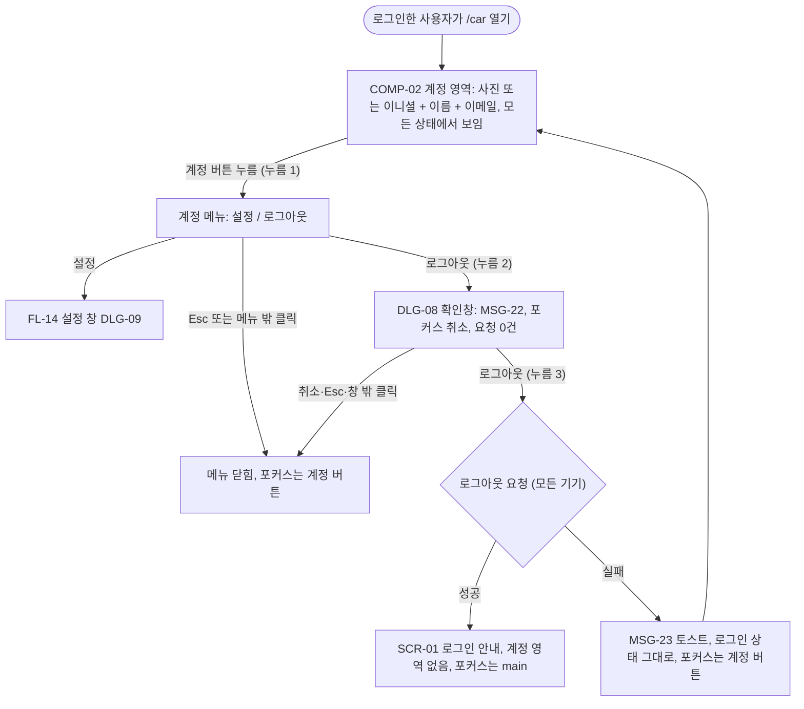
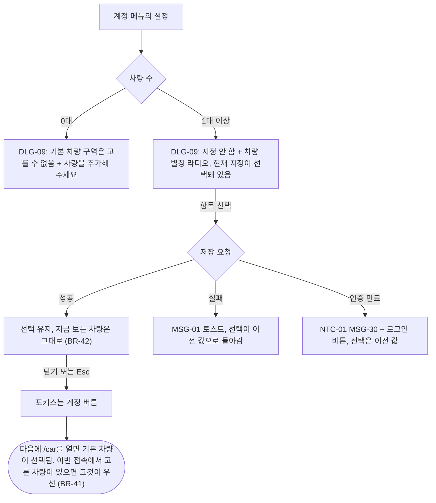
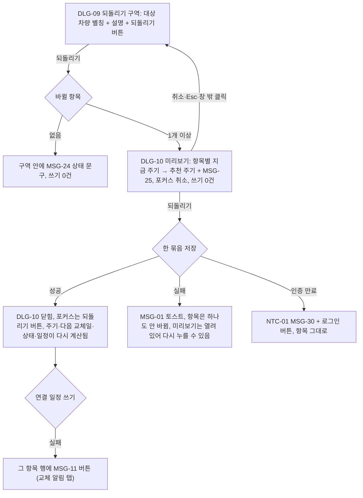
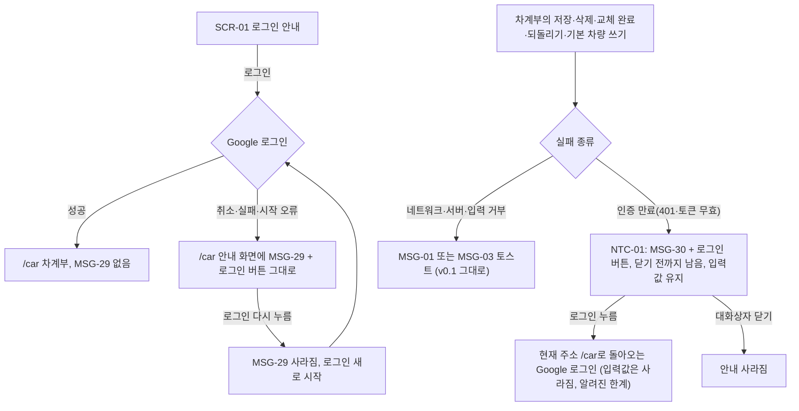
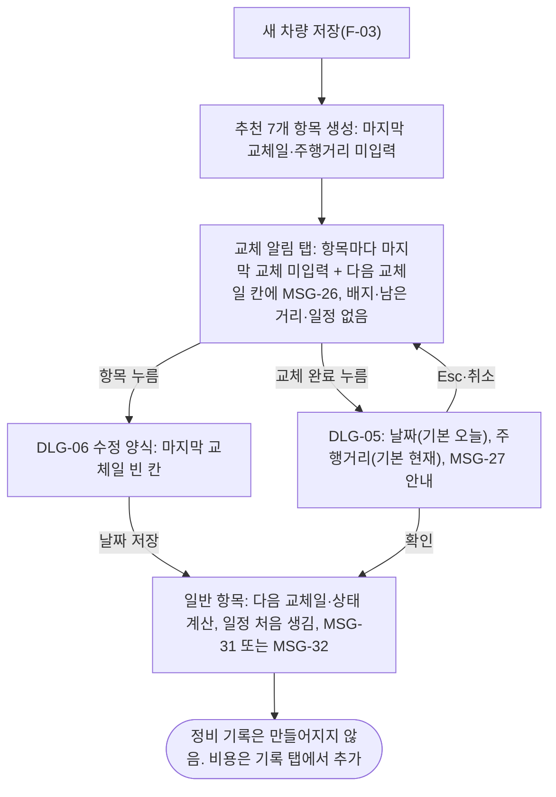
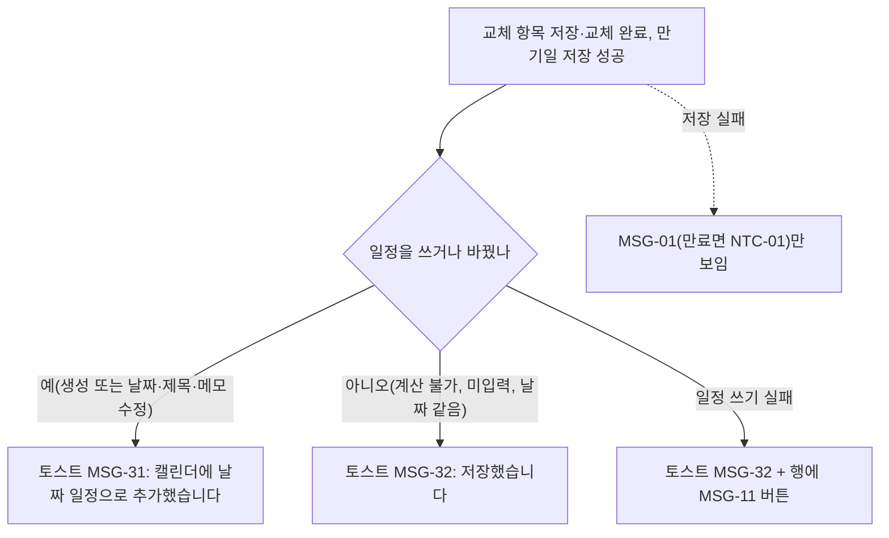
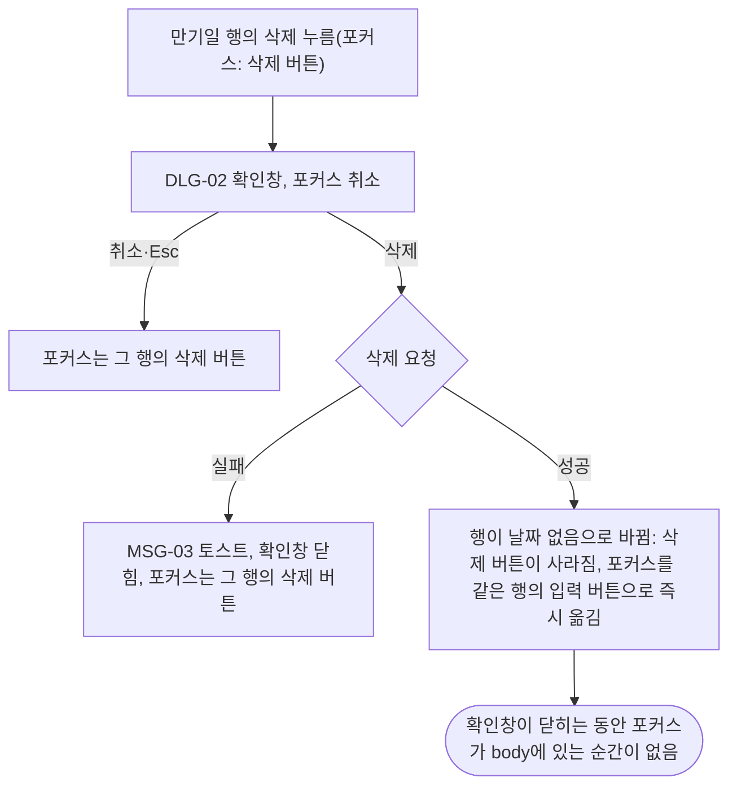

# 사용자 흐름 v0.2 — 차계부 (F-17~F-28)

- 날짜: 2026-11-21 · 소유자: UX Designer · 상태: 초안(UI Designer 검토 대기)
- 근거: [03_spec.md](../03_spec.md) F-17~F-28, [01_prd.md](../01_prd.md) v0.2절 S-8~S-10, [ux-review-v0.1.md](../research/ux-review-v0.1.md)
- 짝 문서: [screens-v0.2.md](screens-v0.2.md)(화면·상태·키보드 순서·폭별 차이). v0.1 흐름은 [flows.md](flows.md)이고 이 문서가 바뀌는 곳만 다룬다.
- 새 화면 ID: `COMP-02` 계정 영역, `DLG-08` 로그아웃 확인, `DLG-09` 설정 창, `DLG-10` 추천 주기 되돌리기 미리보기, `NTC-01` 로그인 만료 안내.
- 캘린더 화면은 바꾸지 않는다(BR-37, BR-58). F-23(재측정)은 화면이 없고, F-26(추정 일정 메모)은 캘린더 일정의 메모 문구라 `/car`에 새 화면이 없다.
- 새 `[가정]`은 맨 아래 UA-12~UA-22에 모았다.

## 흐름 목록

| 흐름 | 스토리 | 기능 | 우선 |
|---|---|---|---|
| FL-13 계정 확인과 로그아웃 | S-8 | F-17, F-18 | Must |
| FL-14 기본 차량 지정 | S-9 | F-19 | Must |
| FL-15 추천 교체 주기 되돌리기 | S-10 | F-20 | Must |
| FL-16 로그인 실패·만료 안내 | — | F-27 | Must |
| FL-17 미입력 항목 채우기와 교체 완료 안내 | — | F-24, F-25 | Must / Should |
| FL-18 저장 성공 안내 | — | F-28, F-26 | Should |
| FL-19 만기일 삭제 뒤 포커스와 재시도 버튼 줄바꿈 | — | F-21, F-22 | Should |

## FL-13 계정 확인과 로그아웃 (F-17, F-18)

- 시작: `/car` 열기. 성공: 누름 3번으로 로그인 안내 화면에 닿는다(PRD G-7). 실패 분기: 로그아웃 요청이 실패하면 토스트만 뜨고 아무것도 바뀌지 않는다.
- 계정 영역은 차량 0대(SCR-03), 목록 불러오기 실패(MSG-04), 로딩 중에도 보인다(AC-17-8). 로그인 안내 화면에는 없다(AC-17-9).
- 사진이 없거나 `https:`가 아니거나 불러오기에 실패하면 이름 첫 글자 원형으로 바뀐다. 이름·이메일과 다른 요소는 움직이지 않는다(사진 자리 크기 고정, BR-36).
- "모든 기기에서 로그아웃된다"는 사실은 MSG-22가 알리는 유일한 자리다.

## FL-14 기본 차량 지정 (F-19)

- 저장 버튼이 없다. 고르는 즉시 저장한다(명세 기본 흐름 2).
- 기본 차량을 지금 바꿔도 화면의 선택 차량은 바뀌지 않는다. 사용자가 "왜 안 바뀌지"라고 느끼지 않도록 구역에 한 줄 안내를 둔다(UA-18).
- 파일철 탭으로 캘린더에 갔다 돌아오면 이번 접속이 끝난 것이라 기본 차량으로 다시 선택되고 하위 탭은 "기록"으로 돌아간다(AC-19-12). 따라서 v0.1의 UA-1(차량을 바꿔도 하위 탭 유지)은 같은 접속 안에서만 해당한다.

## FL-15 추천 교체 주기 되돌리기 (F-20)

- 바뀌는 대상은 선택한 차량 1대다. 설정 창에서 대상 차량의 별칭을 보인다(UA-19). 다른 차량을 되돌리려면 설정을 닫고 차량을 바꾼 뒤 다시 연다.
- 미리보기 한 줄은 항목 이름 아래에 `지금 주기 → 추천 주기`다(예 `15,000km / 6개월 → 10,000km / 12개월`). 마지막 교체일·주행거리, 직접 추가한 항목, 지운 추천 항목은 목록에 없고 바뀌지 않는다는 것은 MSG-25가 말한다.
- 성공 때 새 안내를 만들지 않는 것이 명세(VQ-12)다. 되돌린 결과는 교체 알림 탭에서 보이므로 설정 창이 열린 채로는 아무 변화도 안 보인다. 이 문제는 UA-14로 해결했다. PO가 되돌리기 결과 한 줄을 승인했다(2026-11-24, VQ-12를 이 범위에서 고침, 토스트는 없음).
- 연결 일정 쓰기 실패(MSG-11)는 설정 창 뒤의 교체 알림 탭에 보이므로 사용자는 설정을 닫아야 안다. UA-14의 상태 문구가 이 경우도 알린다.

## FL-16 로그인 실패·만료 안내 (F-27)

- MSG-29는 안내 화면에만, MSG-30은 쓰기를 시도한 대화상자 안에 보인다(UA-15). 둘 다 화면낭독기가 알림으로 읽는다(NFR-21).
- MSG-30이 보이는 동안 양식 입력값은 남는다. 로그인 버튼을 누르면 페이지가 새로 열려 입력값이 사라진다. 모르고 누르지 않도록 버튼 옆에 한 줄 경고를 둔다(UA-16, PO 확정).
- 목록 불러오기 실패(MSG-04)는 이 흐름의 대상이 아니다(VQ-11).

## FL-17 미입력 항목 채우기와 교체 완료 안내 (F-24, F-25)

- 미입력 항목은 목록 맨 뒤에 놓이고(UA-8) 배지가 없다. 신규 사용자는 처음에 7개 모두 "미입력"을 본다. MSG-26이 7번 반복되는 것을 줄이는 방법은 명세 밖 문구이지만 UA-20으로 PO가 확정했다.
- 미입력 항목의 수정 양식은 마지막 교체일 칸이 비어 있다. 오늘로 채우면 가짜 값 문제(U-01)가 다시 생기기 때문이다.
- 교체 완료 대화상자의 MSG-27은 닫을 수 없고, 대화상자를 열 때 화면낭독기가 함께 읽는다(AC-25-4).
- v0.2 이전에 등록한 차량의 항목은 바뀌지 않는다(AC-24-5). 화면은 v0.1과 같다.

## FL-18 저장 성공 안내 (F-28, F-26)

- 토스트는 양식이 닫힌 뒤 뜨고 화면낭독기가 알림으로 읽는다(BR-59).
- 기록·차량 저장, 삭제, 되돌리기에는 성공 토스트를 만들지 않는다(VQ-12).
- F-26: 주행거리 기준 날짜의 연결 일정은 메모에 MSG-28이 들어간다. 이 메모는 캘린더에서만 보인다. `/car` 행에도 "추정" 표시를 두자는 제안은 UA-20이다.

## FL-19 만기일 삭제 뒤 포커스와 재시도 버튼 (F-22, F-21)

- 핵심은 삭제 성공 때 눌렀던 "삭제" 버튼이 사라진다는 점이다. 확인창이 닫힌 뒤 돌려줄 자리가 없어 포커스가 body로 빠진다. 성공 시점에 새로 생긴 "입력" 버튼으로 곧바로 옮기는 것이 설계다(AC-22-1). 문제는 모바일(≤899px)에서 보이지만 모든 폭에서 같게 동작해도 된다.
- 기록·교체 항목·차량의 삭제는 v0.1과 같다(AC-22-4).
- F-21(재시도 버튼 줄바꿈)은 흐름이 아니라 배치다. 배치는 screens-v0.2.md.

## 가정 모음 (v0.2)

| 번호 | 가정 | 이유 | 바뀌면 |
|---|---|---|---|
| UA-12 | 계정 영역은 모든 폭에서 차계부 맨 위 한 줄이고 차량 영역보다 위다 | 시각 순서와 Tab 순서가 같다. 명세는 "차량 선택 줄과 같은 영역"만 정했다 | 데스크톱에서 같은 줄 오른쪽으로 옮기면 DOM 순서도 바꿔야 한다 |
| UA-13 | 기본 차량 값을 읽지 못한 채 설정을 열면 라디오에 선택 표시를 하지 않고 "현재 지정을 불러오지 못했습니다"를 보인다 | 명세는 차계부가 열리는 것까지만 정했다(VQ-5) | 새 문구, PO 확정(2026-11-24) |
| UA-14 | 되돌리기가 끝나면 설정 창의 되돌리기 구역에 상태 한 줄("N개 항목의 주기를 되돌렸습니다"). 일정 쓰기가 실패했으면 "일부 항목은 캘린더에 반영하지 못했습니다. 교체 알림 탭에서 다시 시도하세요"를 더한다 | 성공 안내를 만들지 않는다는 VQ-12와 부딪히지만, 설정 창에서 결과가 안 보이는 H1 문제가 있다 | PO 확정(2026-11-24). 설정 창 안의 한 줄이며 토스트는 없다. VQ-12는 이 범위에서 PO가 고친다 |
| UA-15 | MSG-30 안내(NTC-01)는 쓰기를 시도한 대화상자 안, 버튼 줄 바로 위에 놓이고 대화상자를 닫으면 사라진다. 안내가 보이는 동안 저장·확정 버튼은 비활성이다 | "닫기 전까지"를 대화상자 닫기로 해석했다. 다시 눌러도 같은 실패라서 비활성이다 | PO 해석 확정(2026-11-24): 대화상자가 열린 동안 안내 유지, 안내 중 저장 버튼 비활성 |
| UA-16 | MSG-30의 "로그인" 버튼 옆에 "다시 로그인하면 입력한 내용은 사라집니다" 보조 문구를 둔다 | 알려진 한계(BL-11)를 사용자가 모르고 누르는 것을 막는다(H5) | 새 문구, PO 확정(2026-11-24). MSG 추가는 Spec Writer가 처리 |
| UA-17 | 되돌리기 저장이 실패하면 미리보기 창은 열린 채 다시 누를 수 있다 | 다시 열 필요 없이 재시도(DLG-03 양식과 같은 방식) | 닫는 쪽(DLG-02 방식)도 가능 |
| UA-18 | 기본 차량 구역에 "지금 보는 차량은 그대로이고 다음에 차계부를 열 때부터 적용됩니다" 한 줄을 둔다 | BR-42로 지정해도 화면이 안 바뀐다는 것을 알린다 | 새 문구, PO 확정(2026-11-24) |
| UA-19 | 되돌리기 구역과 미리보기에 대상 차량 별칭을 보인다 | 명세가 "선택한 차량 1대"로 정했는데 사용자가 어느 차인지 알 수 없다 | — |
| UA-20 | 교체 알림 행의 다음 교체일이 km 기준이면 날짜 옆에 "추정"을 붙인다. 미입력 항목이 여럿이면 목록 위에 "마지막 교체일을 입력하면 다음 교체일을 계산합니다" 한 줄을 둔다 | `/car`와 캘린더 메모(F-26)를 맞추고 MSG-26의 7회 반복을 줄인다 | 둘 다 PO 확정(2026-11-24). 요약 한 줄은 행별 MSG-26 표시에 더한다 |
| UA-21 | MSG-24(되돌릴 것 없음)는 확인창이나 토스트가 아니라 되돌리기 구역 안의 상태 문구다 | 명세가 위치를 정하지 않았다 | — |
| UA-22 | ≥1024px에서 MSG-11 버튼은 항목 행 아래 한 줄로 내려 전체 폭을 쓴다(줄바꿈 없음) | BR-48을 열 폭에 의존하지 않고 만족한다 | 대안은 동작 열을 넓히고 띄어쓰기 자리에서만 줄바꿈 |

## 변경 기록

| 날짜 | 변경 | 이유 | 요청자 |
|---|---|---|---|
| 2026-11-21 | v0.2 흐름 FL-13~19 최초 작성 | PO 요청 conv-carbook-v02(MPR-49~60) | Product Owner |
| 2026-11-24 | PO 승인 반영: UA-13·14·15·16·18·20 확정, '승인 필요' 표시를 확정으로 바꿈. UA-12·17·19·21·22는 그대로 | PO agree 2026-11-24(2a35b63) | Product Owner |
