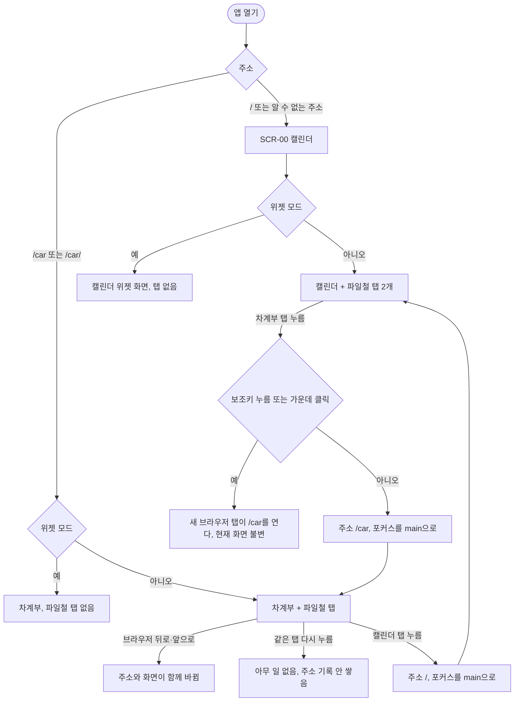
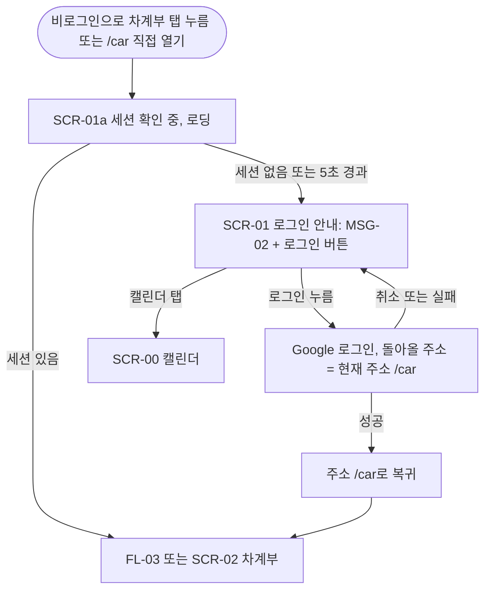
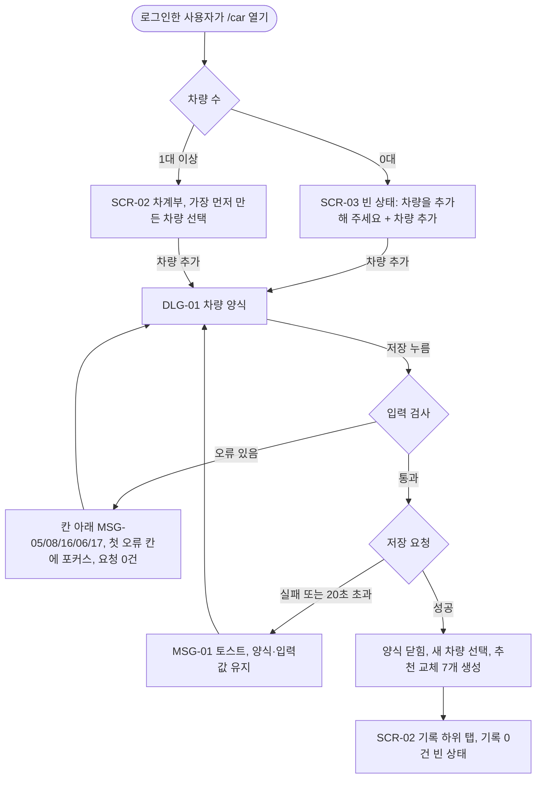
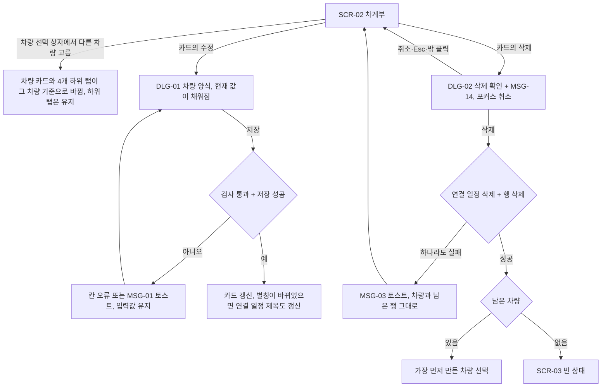
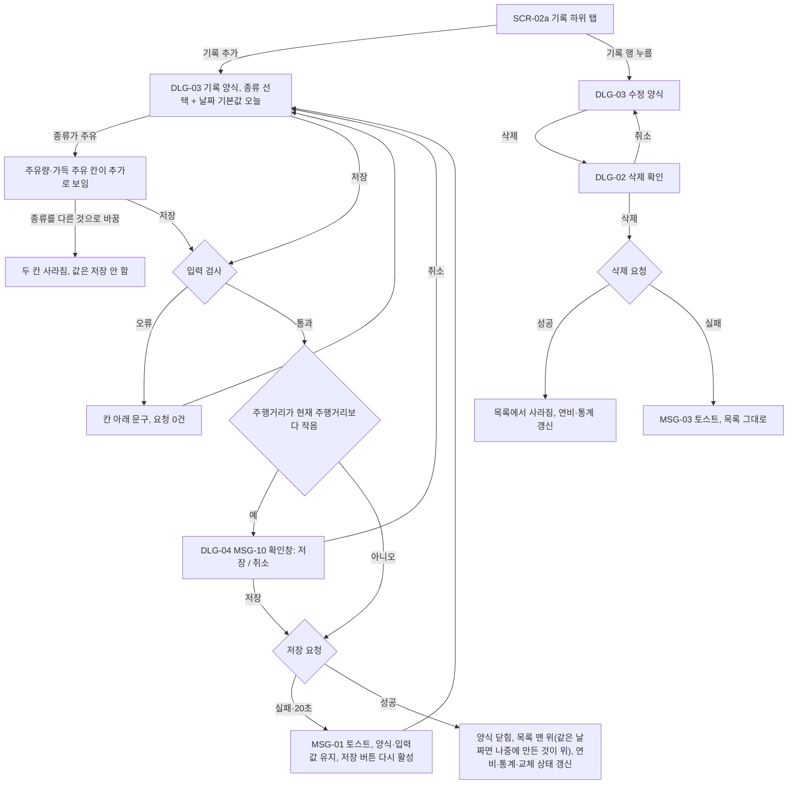
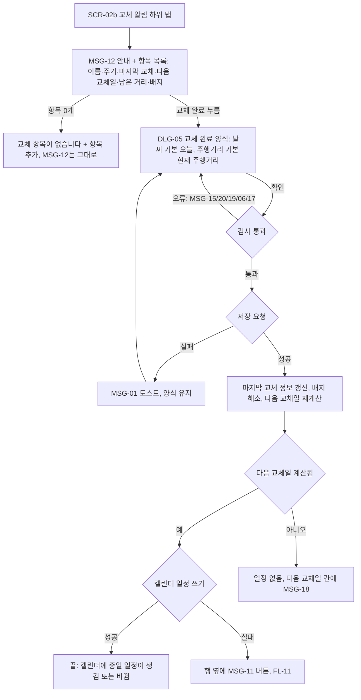
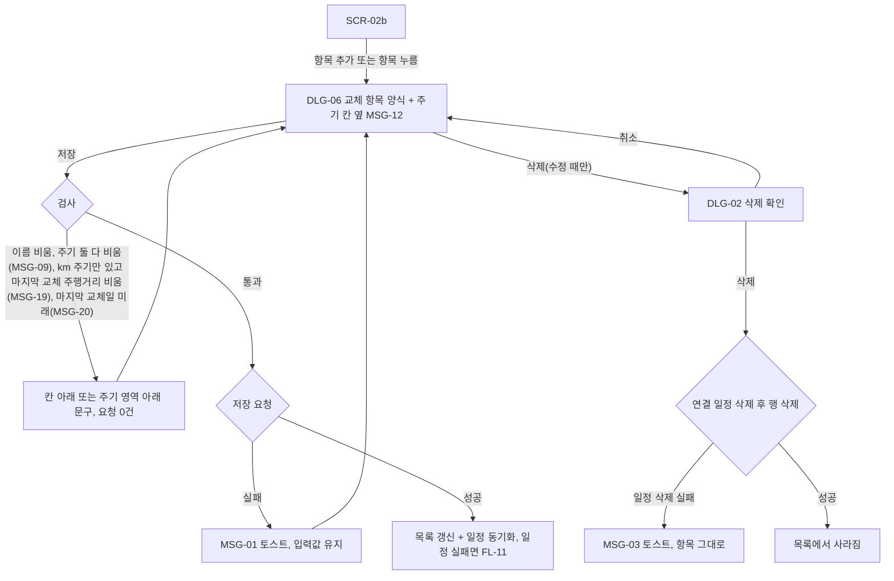
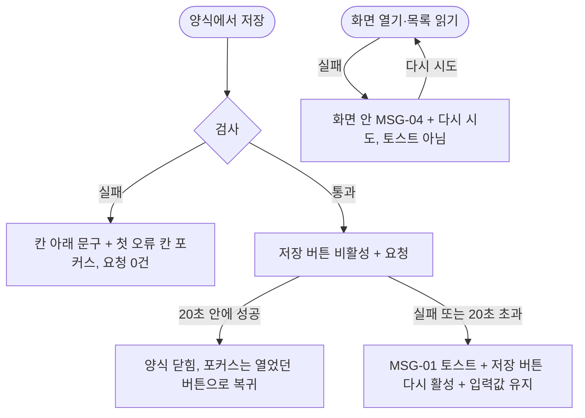
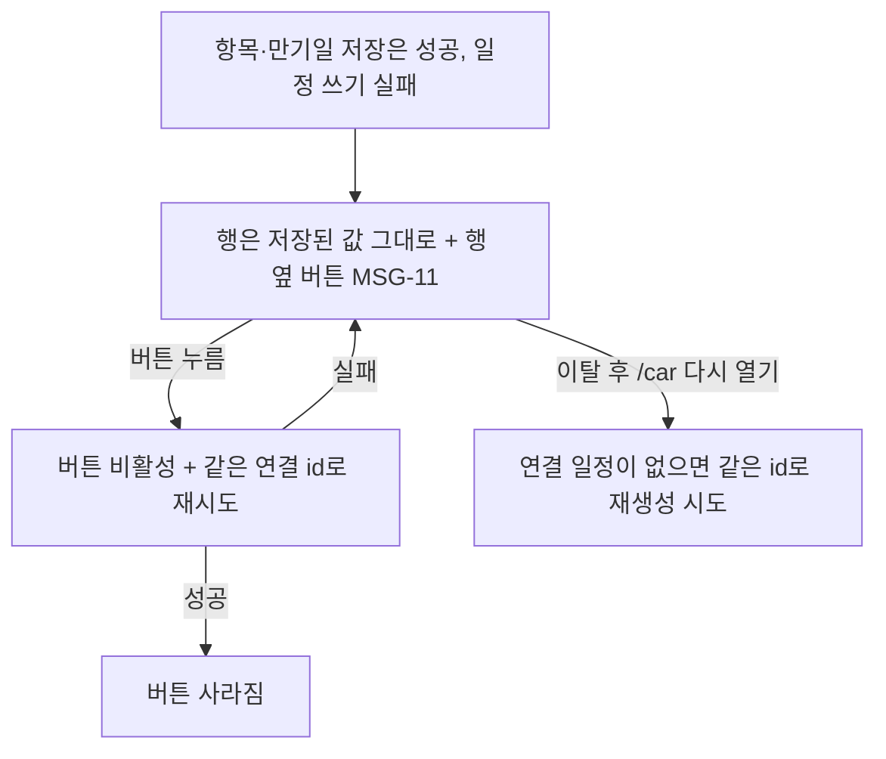
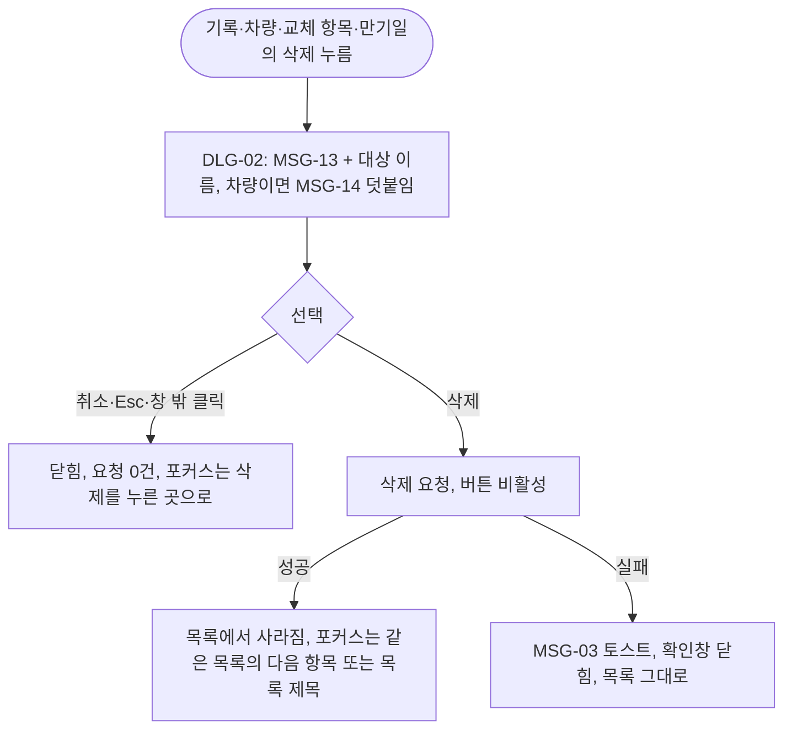

# 사용자 흐름 — 차계부

- 날짜: 2026-11-05 · 소유자: UX Designer · 상태: 초안(Product Owner 설계 검토 대기)
- 근거: [03_spec.md](../03_spec.md)(F-01~F-16, MSG, BR), [01_prd.md](../01_prd.md), [research/tech.md](../research/tech.md) T-4
- 짝 문서: [screens.md](screens.md)(화면 구성·상태·키보드 순서·폭별 차이)
- 표기: 화면 ID(`SCR-nn`)와 대화상자 ID(`DLG-nn`)는 screens.md에 있다. 흐름도의 사각형은 화면, 둥근 상자는 사용자 행동, 마름모는 분기다.
- `[가정]`은 PRD·명세에 없어 내가 정한 사용자 행동이다. 맨 아래 9장에 모았다.

## 1. 흐름 목록

| 흐름 | 스토리(PRD S-n) | 기능 | 우선 |
|---|---|---|---|
| FL-01 화면 전환(파일철 탭) | — | F-01, F-13, F-14 | Must |
| FL-02 로그인 안내와 복귀 | S-6 | F-02 | Must |
| FL-03 차량 추가와 추천 항목 채움 | S-1 | F-03 | Must |
| FL-04 차량 선택·수정·삭제 | — | F-03, F-11 | Must |
| FL-05 기록 추가(주유 중심)·수정·삭제 | S-2 | F-04, F-05, F-10, F-11 | Must |
| FL-06 교체 알림 확인·교체 완료 | S-3 | F-06, F-08, F-12 | Must |
| FL-07 교체 항목 추가·수정·삭제 | — | F-06, F-08, F-11, F-12 | Must |
| FL-08 만기일 입력·수정·삭제 | S-4 | F-07, F-08, F-15 | Must |
| FL-09 통계 보기 | S-5 | F-09, F-05 | Must |
| FL-10 저장 실패·검사 오류·불러오기 실패 | S-7 | F-10 | Must |
| FL-11 캘린더 반영 실패 재시도 | — | F-08, F-10 | Must |
| FL-12 삭제 확인(공통) | — | F-11 | Should |

F-16(공유 상대에게 숨김)은 사용자가 하는 행동이 없고 소유자 화면이 변하지 않으므로 별도 흐름·화면이 없다. 확인 지점만 FL-06·FL-08 성공 분기에 적었다.

## 2. FL-01 화면 전환 (F-01, F-13, F-14)



- 시작: 앱 열기. 성공: 누른 탭의 화면이 보이고 그 탭이 현재 탭(`aria-current="page"`, 모양 구분)이다. 실패 분기는 없다(주소가 바뀌는 동작뿐이고 데이터 요청은 화면 안에서 처리).
- 모바일(≤899px)은 같은 흐름이고 탭 위치만 다르다(screens.md 4장). 새 일정 편집창이 열려 있으면 탭은 오버레이 뒤에 가려지므로 먼저 편집창을 닫아야 한다.
- 위젯 모드에서 `/car`를 직접 열면 탭이 없으므로 돌아가는 길은 브라우저 뒤로 가기뿐이다(F-13).

## 3. FL-02 로그인 안내와 복귀 (F-02)



- 성공: 로그인 뒤 `/car`에서 기록 하위 탭이 열린다(`/`로 가지 않는다).
- 실패: 안내 화면에 머문다. 차계부 데이터 요청은 어떤 분기에서도 0건이다(BR-03).
- 로그인 중 세션이 만료되면 목록 영역에 MSG-04와 "다시 시도"가 뜬다(FL-10).

## 4. 차량 흐름 (F-03, F-11)

### FL-03 차량 추가와 추천 항목 채움



- 필수는 별칭 하나뿐(BR-05). 나머지는 비워도 저장된다.
- 성공 때 캘린더 일정은 만들지 않는다(BR-06). 교체 알림 탭에서 7개 항목은 보이지만 일정은 사용자가 항목을 저장하거나 교체 완료할 때 생긴다.
- 주행거리를 비운 차량은 교체 알림 탭에서 km 항목이 "주행거리 기록 부족"으로 보인다(BR-06a). 안내 문구를 따로 만들지 않고 MSG-18을 쓴다.

### FL-04 차량 선택·수정·삭제



- 하위 탭은 차량을 바꿔도 유지한다. `[가정]` 명세는 "처음 열면 기록"만 정했다. 차량을 바꿀 때 하위 탭을 되돌리면 비교(두 대의 통계)가 번거로워서 유지로 정했다.
- 선택한 차량은 새로고침하면 가장 먼저 만든 차량으로 돌아간다(명세 1.5). 선택을 저장하지 않는다.

## 5. 기록 흐름 (F-04, F-05, F-10, F-11)

### FL-05 기록 추가·수정·삭제



- 성공: 목록과 맨 위 연비가 다시 불러오기 없이 갱신된다(NFR-03).
- 연비는 가득 주유 2건 이상일 때만 숫자가 나온다. 그렇지 않으면 "연비: 가득 주유 기록이 2건 이상 필요합니다"를 같은 자리에 보인다(F-05). 이것은 오류가 아니라 정상 빈 상태다.
- 저장 중 저장 버튼은 비활성이다(AC-10-2).
- 주유 입력을 최소로 하려고 양식의 첫 칸은 종류, 둘째 날짜, 셋째 금액으로 둔다. `[가정]` 사용자는 주유 후 날짜·금액·주행거리·주유량·가득 여부를 입력한다(PRD S-2).

## 6. 교체 알림·만기일 흐름 (F-06, F-07, F-08, F-12, F-15)

### FL-06 교체 알림 확인과 교체 완료



- 교체 완료는 정비 기록을 자동으로 만들지 않는다(BR-15). 화면에 "정비 기록도 추가할까요" 같은 제안을 두지 않는다(범위 밖).
- 상태 배지는 색만이 아니라 글자("곧 교체", "교체 시기 지남")로 보인다. 정상은 배지가 없다.

### FL-07 교체 항목 추가·수정·삭제



### FL-08 만기일 입력·수정·삭제

```mermaid
flowchart TD
    A[SCR-02c 만기일 하위 탭: 보험·자동차세·정기검사 3행] --> B{행에 날짜 있음}
    B -- 없음 --> C["날짜 없음" + 입력 버튼]
    B -- 있음 --> D[날짜 + 수정 버튼 + 삭제 버튼]
    C -- 입력 --> E[DLG-07 만기일 양식]
    D -- 수정 --> E
    E -- 자동차세일 때 --> E2["6월 30일" / "12월 31일" 빠른 선택, 누르면 날짜 칸만 채움]
    E2 --> E
    E -- 저장 --> F{검사}
    F -- 비움·형식 오류(MSG-05/15) --> G[칸 아래 문구, 요청 0건]
    G --> E
    F -- 통과 --> H{저장 요청}
    H -- 실패 --> I[MSG-01 토스트, 입력값 유지]
    I --> E
    H -- 성공 --> J[행 갱신 + 일정 만들기·고치기, 일정 실패면 FL-11]
    D -- 삭제 --> K[DLG-02 삭제 확인]
    K -- 삭제 --> L{연결 일정 삭제 후 행 삭제}
    L -- 성공 --> M["날짜 없음"으로 돌아감]
    L -- 일정 삭제 실패 --> N[MSG-03 토스트, 행 그대로]
    K -- 취소 --> D
```

- 빠른 선택 버튼은 저장도, 일정 생성도 하지 않는다(BR-18). 양식을 저장 없이 닫으면 아무것도 남지 않는다(AC-15-3).
- 지난 날짜도 저장된다. 경고를 띄우지 않고 배지도 없다(F-07).
- 성공 확인: 사용자가 "캘린더" 탭으로 가면 3초 안에 해당 일정이 보인다(AC-08-12). 차계부 화면에는 "캘린더에 추가됨" 같은 별도 안내를 두지 않는다. `[가정]` 일정 연결은 결과가 눈에 보이는 캘린더에서 확인하고, 실패만 행 옆 MSG-11로 알리는 편이 소음이 적다.
- 공유 상대에게는 이 일정이 보이지 않는다(F-16). 소유자 화면은 달라지지 않는다.

## 7. 통계 흐름 (F-09, F-05)

```mermaid
flowchart TD
    A[SCR-02d 통계 하위 탭] --> L{불러오기}
    L -- 실패 --> R[MSG-04 + 다시 시도]
    R -- 다시 시도 --> L
    L -- 성공 --> B[월 선택: 기본 이번 달]
    B --> C{선택한 달 기록}
    C -- 있음 --> D[총합 + 종류별 합계 금액 큰 순]
    C -- 없음 --> E["0원" + "이 달의 기록이 없습니다"]
    B -- 이전·다음 달 --> B
    D --> F[월별 합계 최근 12개월 + 연비 변화 목록]
    E --> F
    F -- 연비 구간 없음 --> G["가득 주유 기록이 2건 이상 필요합니다"]
```

- 하위 탭을 오가거나 기록을 고치고 통계 탭으로 돌아오면 합계가 이미 바뀌어 있다(AC-09-6).
- 월 선택이 바뀌어도 아래 12개월 목록은 바뀌지 않는다(AC-09-7).

## 8. 공통 흐름

### FL-10 저장 실패·검사 오류·불러오기 실패 (F-10)



- 검사 오류는 저장 버튼을 누를 때 한꺼번에 보인다(1.3). 입력 도중에는 오류를 띄우지 않는다.
- 토스트는 기존 토스트 장치를 쓰고(F-10) 화면낭독기에 읽힌다. 토스트가 사라져도 양식과 입력값은 남는다.

### FL-11 캘린더 반영 실패 재시도 (F-08)



- 저장 입력은 이미 성공했으므로 양식을 다시 열지 않는다. 버튼만 누르면 된다.
- 재시도를 연타해도 일정은 1건이다(AC-08-6). 버튼은 진행 중 비활성이다.

### FL-12 삭제 확인 공통 (F-11)



- 확인창을 열면 포커스는 "취소"에 있다. 삭제가 기본 동작이 되지 않게 하려는 것이다.

## 9. 가정 모음

| 번호 | 가정 | 이유 | 바뀌면 |
|---|---|---|---|
| UA-1 | 차량을 바꿔도 하위 탭을 유지한다 | 두 차량 비교가 쉽다 | 명세 1.5에 한 줄 추가를 PO에게 요청 |
| UA-2 | 만기일·교체 일정 연결의 성공은 별도 안내를 보이지 않는다 | 결과가 캘린더에서 보이고, 소음이 적다 | 토스트 한 줄 추가는 화면 영향이 작다 |
| UA-3 | 삭제 성공 뒤 포커스는 같은 목록의 다음 항목, 없으면 그 목록의 제목 | 키보드 사용자가 맥락을 잃지 않는다 | Frontend와 조정 |
| UA-4 | 사용자는 주유 후 양식 첫 입력으로 종류·날짜·금액을 먼저 넣는다 | PRD S-2, 최소 입력 | 순서만 바뀐다 |
| UA-5 | `/car`에서는 새 일정 버튼(FAB)이 없다 | BR-34로 캘린더 화면이 그려지지 않는다. FAB이 App에 남아 있어도 탭 위치(screens.md 4장)는 FAB과 겹치지 않게 정했다 | Frontend 확인 |
| UA-6 | 안드로이드 제스처 내비게이션의 오른쪽 가장자리 '뒤로' 제스처가 탭과 겹칠 수 있다 | 실기기 미확인(tech.md T-4) | screens.md 4.4의 대안 위치로 이동 |
